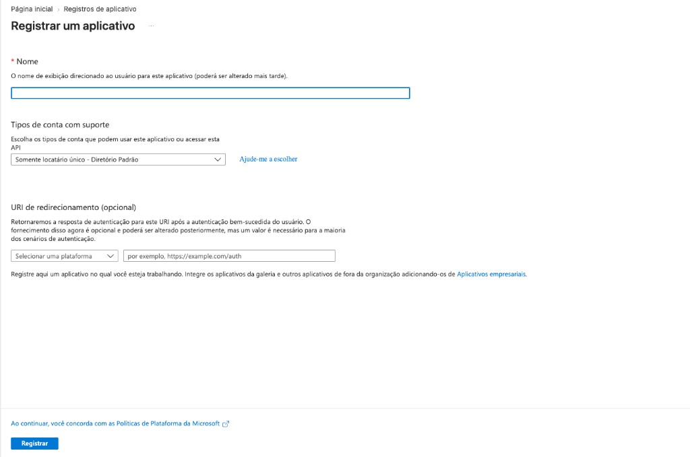
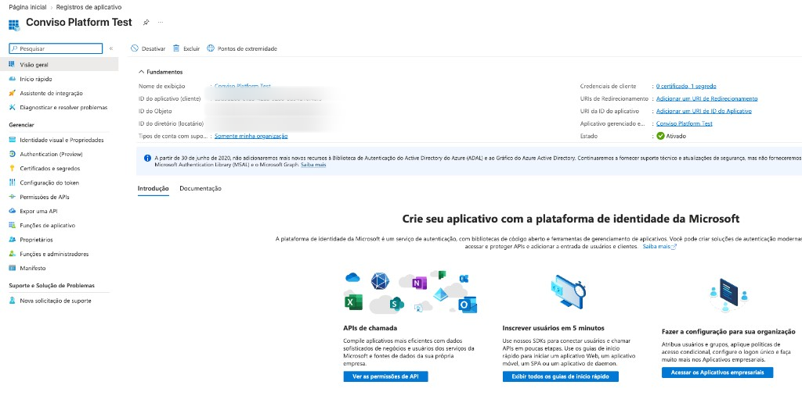
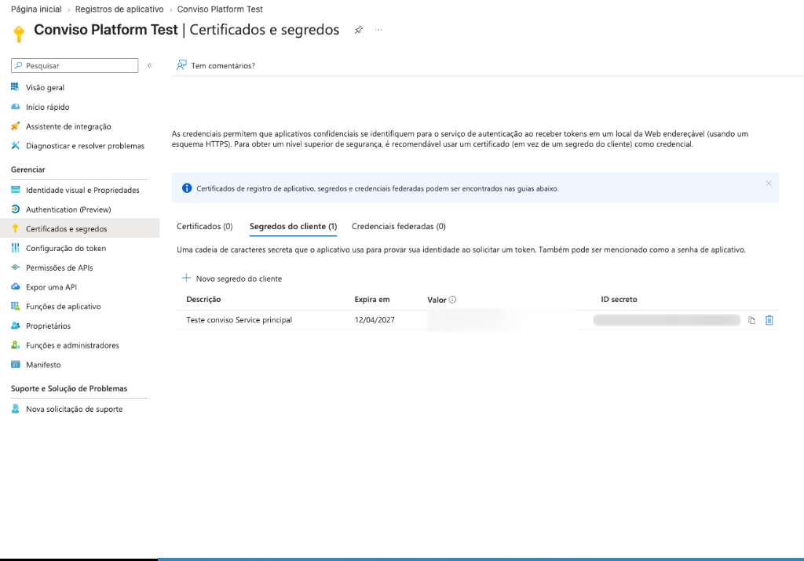
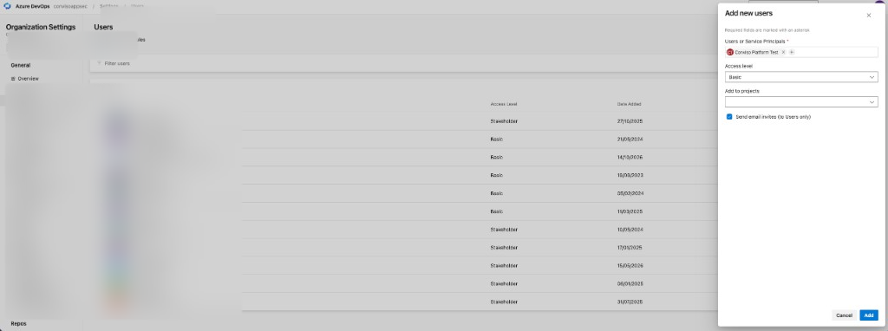
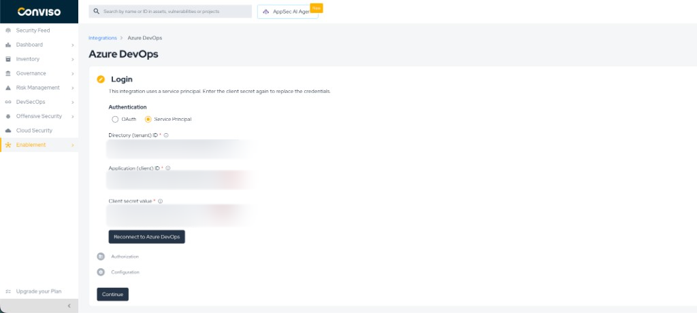
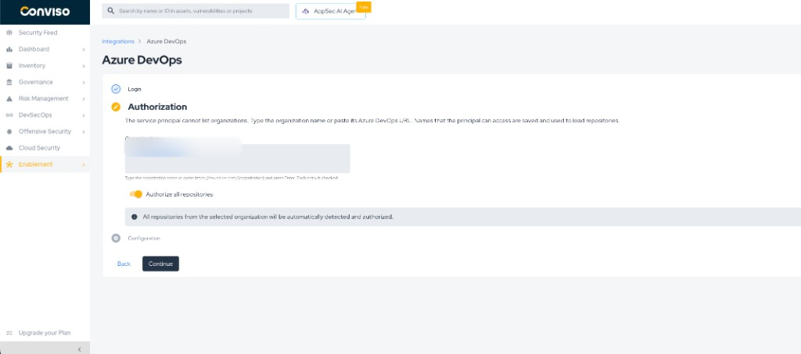

# Azure DevOps Service Principal

Connect Azure DevOps using a **service principal**: an app registration in Microsoft Entra ID with a client secret, instead of signing in with OAuth.

On Login, Conviso sends the tenant ID, client ID and client secret to Microsoft Entra ID and stores them encrypted. The secret is not shown again in the UI. Azure DevOps does not list organizations for a service principal, so on Authorization you type each organization name (or paste `https://dev.azure.com/{organization}`). Conviso checks that the principal can access that organization before saving it.

For OAuth (interactive sign-in), see [Azure DevOps Integration](./azure-devops.md).

## Prerequisites

- Azure DevOps Services.
- Permission in **Microsoft Entra ID** to create an app registration and a client secret.
- Permission in each **Azure DevOps organization** to add the application as a user.
- On that organization, an **access level of Basic or higher** for the application. Azure Repos is not available at Stakeholder. Basic is the access level; it does **not** by itself allow Service Hooks.
- On each **Azure DevOps project** whose repositories you import: project access, plus **View subscriptions** and **Edit subscriptions** (see [Service Hooks](#service-hooks)). Project Administrators have those two permissions by default.
- A Conviso Platform company where the Azure DevOps integration is available.

## Part A – Microsoft Entra ID

Create the app that Conviso will use on Login. Microsoft documents the Azure DevOps side of service principals here: [Service principals and managed identities](https://learn.microsoft.com/en-us/azure/devops/integrate/get-started/authentication/service-principal-managed-identity).

### A1 – Create the app registration

1. Open the [Microsoft Entra admin center](https://entra.microsoft.com/) → **Identity** → **Applications** → **App registrations** → **New registration**.
2. Name the application.
3. Register the app. A redirect URI is not required for this Conviso flow.

*Register an application in Microsoft Entra ID.*

### A2 – Copy Directory (tenant) ID and Application (client) ID

On the app’s **Overview** page, copy:

- **Directory (tenant) ID**
- **Application (client) ID**

These are the values you paste into Conviso on Login.

*Overview – copy Directory (tenant) ID and Application (client) ID.*

### A3 – Create a client secret

1. Open **Certificates & secrets** → **Client secrets** → **New client secret**.
2. Create the secret and copy the **Value** immediately. You cannot view it again later.

:::warning
In Conviso paste the secret **Value**, not the **Secret ID**.
:::

*Certificates & secrets – use the Value column, not Secret ID.*

## Part B – Azure DevOps

The Entra app must be added to every Azure DevOps organization you will enter in Conviso. Conviso cannot add the application for you — Azure DevOps only allows an organization administrator to grant that membership.

For **each** organization (`https://dev.azure.com/{organization}`):

1. Open **Organization settings** → **Users** → **Add users**.
2. Select the application (service principal) from Entra.
3. Set the **access level** to **Basic** or higher (Basic + Test Plans, or Visual Studio Subscriber). Stakeholder cannot use Azure Repos, so Conviso cannot list or import repositories.
4. Choose which **projects** the application can access (see [Project access](#project-access-important-for-new-projects)). Prefer **all projects** when your policy allows it.
5. On **each project you will import**, grant **View subscriptions** and **Edit subscriptions** (see [Service Hooks](#service-hooks)). Adding the application to **Project Administrators** on that project is the default way Microsoft grants both. Project or repository access alone does not.
6. Save.

*Organization settings → Users → Add new users (service principal).*

Use the organization name from the URL (`{organization}`) in Conviso. You can paste the full `https://dev.azure.com/{organization}` URL; Conviso extracts the name.

### Service Hooks

After you authorize repositories, Conviso calls Azure DevOps `_apis/hooks/subscriptions` on each project to register Service Hooks for:

- a **new repository** (`git.repo.created`)
- a pull request **created or updated** (PR scans)
- a pull request **merged** (AST on merge)

Microsoft documents that listing and creating those subscriptions requires **View subscriptions** and **Edit subscriptions**. Both default to **Project Administrators** only. They are project permissions, separate from the organization **access level** (Basic) and from Contributors / Readers on the repo.

A principal with Basic access and project membership can still pass Conviso Login and import assets. Hook creation then fails without blocking the import, so **Project settings → Service hooks** stays empty and later PR or merge events never reach Conviso.

On every project you import, do one of the following:

- Add the Entra application to the **Project Administrators** group, or
- Open **Project settings → Permissions**, select the application (or a group it belongs to), and set **View subscriptions** and **Edit subscriptions** to **Allow**.

Same requirement as OAuth. How to confirm the Web Hooks exist: [Service hook permissions](./azure-devops.md#service-hook-permissions).

### Project access (important for new projects)

When you add the application as a user, Azure DevOps asks which projects it may use.

| Choice in Azure DevOps | What happens later |
|------------------------|--------------------|
| **All projects** (recommended for Conviso) | New projects created in that organization inherit access. Repositories in those projects can appear in Conviso without editing the user again. |
| **Specific projects only** | Only the projects you pick are visible to the application. A **new** Azure DevOps project does **not** inherit access. You must open **Organization settings → Users**, edit the application, and add the new project to its list before Conviso can list or import its repositories. |

This is an Azure DevOps permission boundary, not a Conviso setting. The repository picker in Authorization only shows what the service principal is allowed to see.

:::tip
Prefer **all projects** for the service principal in each organization you connect, unless your security policy requires a fixed project allowlist.
:::

A **new Azure DevOps organization** is different: you must run Part B again for that organization (Add users), then type the organization name on Authorization in Conviso.

## Part C – Conviso Platform

### C1 – Open the integration

1. Open **Integrations**.
2. Open **Azure DevOps** and click **Connect** (or open an existing integration to reconnect).

### C2 – Login

1. Under **Authentication**, select **Service Principal**.
2. Fill in **Directory (tenant) ID**, **Application (client) ID**, and **Client secret value**.
3. Click **Connect to Azure DevOps**.

*Login – Service Principal credentials.*

On success, Conviso moves to **Authorization**.

If the company already had an Azure DevOps integration (for example OAuth) and you connect with a service principal, Conviso keeps only the organizations already stored that this principal can still access. Review the list on Authorization.

### C3 – Authorization

1. In **Organizations**, type the organization name or paste its Azure DevOps URL and press Enter.
2. Conviso verifies each name. Accepted names are saved; a name the principal cannot access stays on the field with an error.
3. Choose **Authorize all repositories** or select specific repositories. If a repository or project is missing from the list, the application usually does not have access to that Azure DevOps project yet — fix project access in Part B, then open the repository select again.
4. Click **Continue**. Conviso then imports assets and attempts to create Service Hooks on each project. If the application is not a Project Administrator (or lacks Edit/View subscriptions), the import can succeed while no hooks appear in Azure.

*Authorization – type organization names (chips).*

### C4 – Configuration

On **Configuration** you can review imported assets, use **Check connection**, and **Remove integration**.

**Check connection** renews the application token with Entra and checks each configured organization. It fails if no organizations are configured.

## Rotating the client secret

1. In Entra, create a new client secret and copy the **Value**.
2. In Conviso, open the Azure DevOps integration → **Login** → **Service Principal**.
3. Paste the new secret (and the same tenant ID and client ID if needed) and connect again.
4. Confirm the organizations on **Authorization**, then use **Check connection** if you want to verify.

## Troubleshooting

| Problem | What to do |
|--------|------------|
| Connect fails / credentials rejected | Check tenant ID, client ID, and the secret **Value** (not Secret ID). Confirm the secret has not expired and the app is in the correct tenant. |
| Organization access denied when adding a name | Add the service principal to that Azure DevOps organization (Part B) and ensure it can access the organization, then try again. |
| New Azure DevOps project / repos missing in Conviso | The app was likely limited to specific projects. In Azure DevOps, edit the application under **Organization settings → Users** and add the new project (or switch the user to **all projects**). Conviso cannot grant that access. |
| Assets imported, but no PR scan, merge AST, or new-repo import — and **Service hooks** is empty | Hook creation failed silently. The application has project access but not **View subscriptions** and **Edit subscriptions**. Add it to **Project Administrators** (or set both to **Allow**) on that project, then re-import so Conviso can register the subscriptions. See [Service Hooks](#service-hooks). |
| No organization dropdown | Expected for Service Principal. Type the organization names instead. |
| Check connection fails with no organizations | Add at least one organization on Authorization. |
| After switching from OAuth, organizations disappeared | Those names were not accessible with the new principal and were removed. Fix membership in Azure DevOps, then add the names again on Authorization. |

## Related guides

- [Azure DevOps Integration](./azure-devops.md)

**[Explore other Conviso Platform integrations.](https://bit.ly/3NzvomE)**
