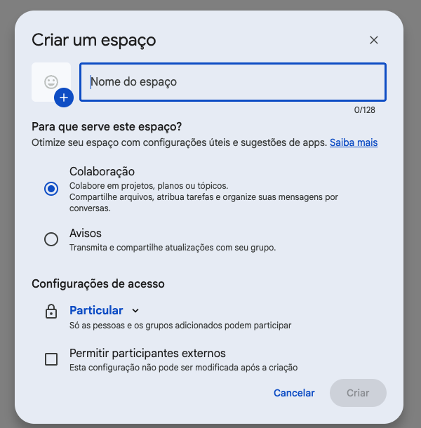
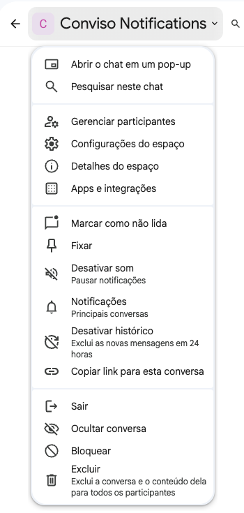
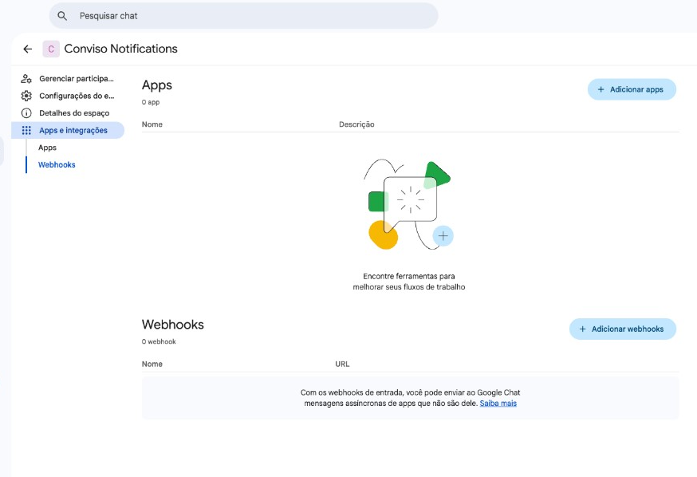
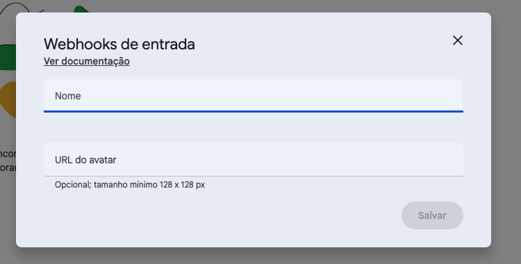
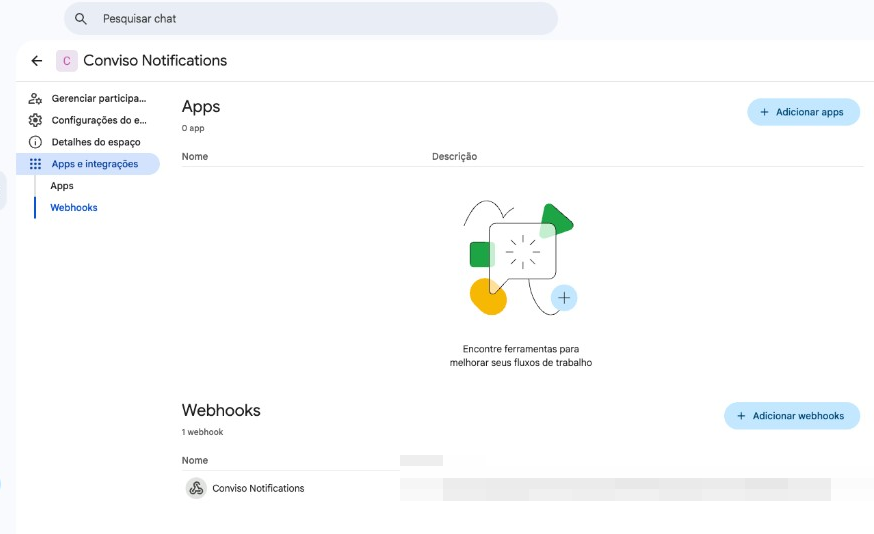
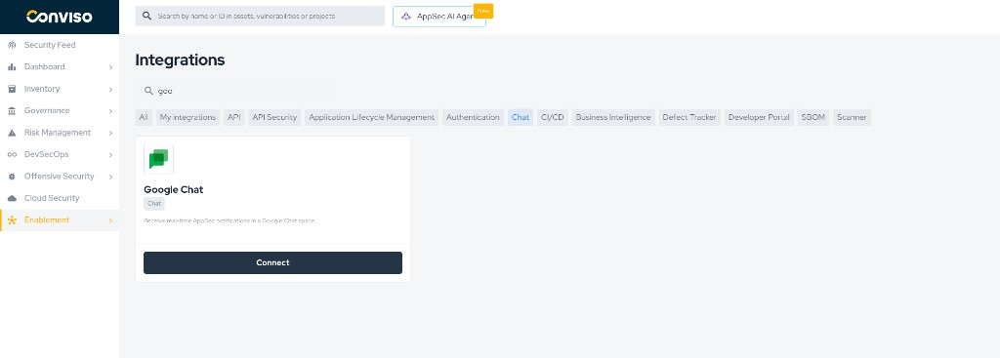
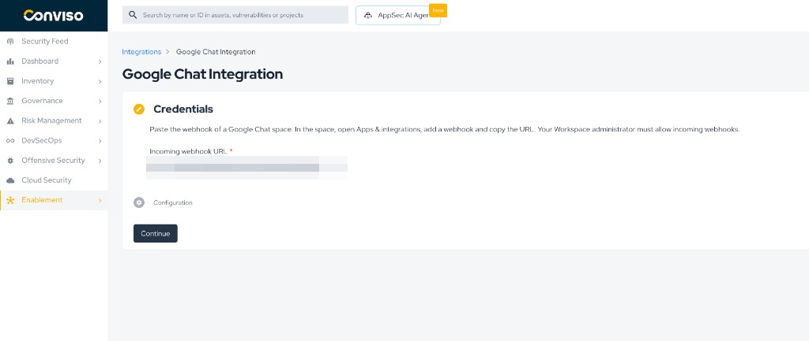
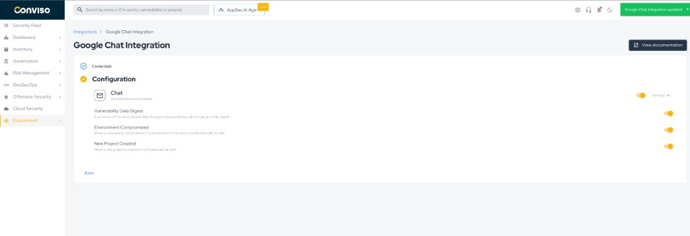
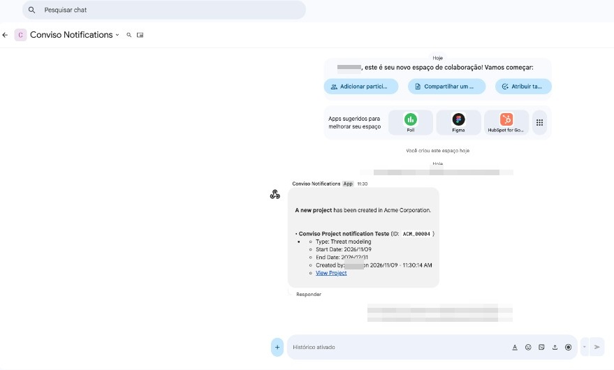

<div style={{textAlign: 'center'}}>


</div>

## Objective

Connect one Google Chat space to Conviso Platform. The space then receives the chat notifications you enable: the Vulnerability Daily Digest, Environment Compromised, and New Project Created.

The connection is an incoming webhook. Conviso Platform posts messages into the space. The space cannot reply, and the webhook cannot read messages already there.

## Prerequisites

- A Google Workspace account. A personal `@gmail.com` account can open Chat, but it cannot create an incoming webhook.
- Permission, from a Workspace administrator, to add incoming webhooks. In the [Google Admin console](https://admin.google.com), the setting is **Apps → Google Workspace → Google Chat → Chat apps → Allow users to add and use incoming webhooks**. Google documents it in [Allow users to install Chat apps](https://knowledge.workspace.google.com/admin/chat/allow-users-to-install-chat-apps).
- A Chat space where you can add a webhook. A direct message does not offer this option. Create a space for the notifications if you do not want them in an existing one.
- Access to **Integrations** in Conviso Platform for the company that should send the notifications.

## Create the webhook in Google Chat

Use Chat in a browser. The mobile app cannot add a webhook. Google Chat follows the language of the Google account. The screens below are in Portuguese. In English, the same actions are **Create a space**, **Apps & integrations**, **Add webhooks**, and **Save**.

1. Open [Google Chat](https://chat.google.com). From **New chat**, select **Create a space**. Name the space, keep it private, and create it. A direct message cannot host this webhook.

<div style={{textAlign: 'center'}}>



</div>

2. Next to the space name, open the space menu and select **Apps & integrations**.

<div style={{textAlign: 'center'}}>



</div>

3. Under **Webhooks**, select **Add webhooks**.

<div style={{textAlign: 'center'}}>



</div>

4. Enter a name, such as `Conviso Platform`. Leave **Avatar URL** empty. Select **Save**.

<div style={{textAlign: 'center'}}>



</div>

5. The webhook is listed in the space. Open its more menu and select **Copy link**.

<div style={{textAlign: 'center'}}>



</div>

The link looks like this:

```text
https://chat.googleapis.com/v1/spaces/SPACE_ID/messages?key=KEY&token=TOKEN
```

:::caution Keep the link private
Anyone who has the link can post messages in that space. Do not paste it into chat, email, or a ticket. Each link belongs to one space. Another space needs its own webhook.
:::

## Connect the webhook in Conviso Platform

1. In Conviso Platform, open **Integrations**, filter by **Chat**, and select **Connect** on the Google Chat card.

<div style={{textAlign: 'center'}}>



</div>

2. Paste the link into **Incoming webhook URL** and select **Continue**. The field accepts only an `https` link on `chat.googleapis.com` whose path is `/v1/spaces/SPACE_ID/messages`.

<div style={{textAlign: 'center'}}>



</div>

3. Open **Settings** and enable the notifications the space should receive:

   - **Vulnerability Daily Digest** — one message each morning, around 7:30 (Brasília time), covering the previous day. See [Vulnerability Daily Digest](../platform/notifications-center.md#vulnerability-daily-digest).
   - **Environment Compromised** — sent when a vulnerability compromises an asset's environment.
   - **New Project Created** — sent when a project is created.

   A switch turns off that notification for this integration. The choice is saved as you change it.

<div style={{textAlign: 'center'}}>



</div>

:::note The space receives one person's notifications
The webhook is tied to the account that saved the integration. The space receives that account's notifications, and the digest only includes what that person is allowed to see. If the account is deactivated or loses access to the company, the space goes quiet.
:::

## Validation

Create a project in the company. With **New Project Created** enabled, the space receives a message for that project, including a link back to the platform.

<div style={{textAlign: 'center'}}>



</div>

The digest does not arrive at setup time. It is sent the next morning, and a day with nothing to report produces no message.

## Replace or remove the webhook

To point the integration at another space, create a webhook in that space and copy the new link. In Conviso Platform, open the Google Chat integration. If the page opens on **Configuration**, select **Back**. Replace **Incoming webhook URL**, then select **Continue**. The notification switches stay as they are.

To stop delivery, open **Credentials** and select **Remove integration**, then confirm. The space keeps its webhook until someone deletes it in Google Chat. Deleting the webhook in Chat also stops delivery, because the saved link no longer accepts messages.

## Troubleshooting

**Add webhooks is missing or cannot be clicked.** The signed-in account is a personal Gmail account, or the Workspace administrator has not turned on **Allow users to add and use incoming webhooks**. Installing an app from **Add apps** does not create this webhook.

**Continue rejects the link.** Copy the link again from the webhook's more menu. It must be `https://chat.googleapis.com/v1/spaces/SPACE_ID/messages`, with the key and token Google added. A shortened link or a link from another product is rejected.

**No message arrives.** Confirm the switch for that event is on, and that you are acting in the same company where you saved the integration. **New Project Created** is the check you can run immediately. The digest waits until the next morning, and a quiet day sends nothing. If the account that connected the integration lost access, reconnect with an account that still has it.

**The message arrived in the wrong space.** The link posts only to the space where it was created. Replace it with the webhook of the space you want.

## Support

If you have any questions or need help using our product, please contact our [support team](mailto:support@convisoappsec.com).
