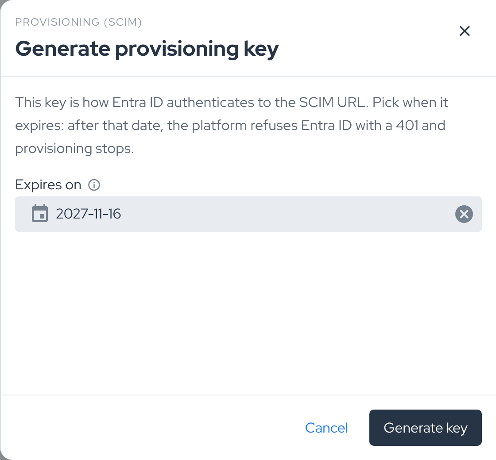
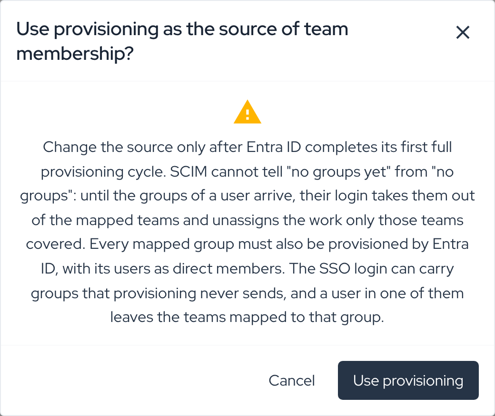
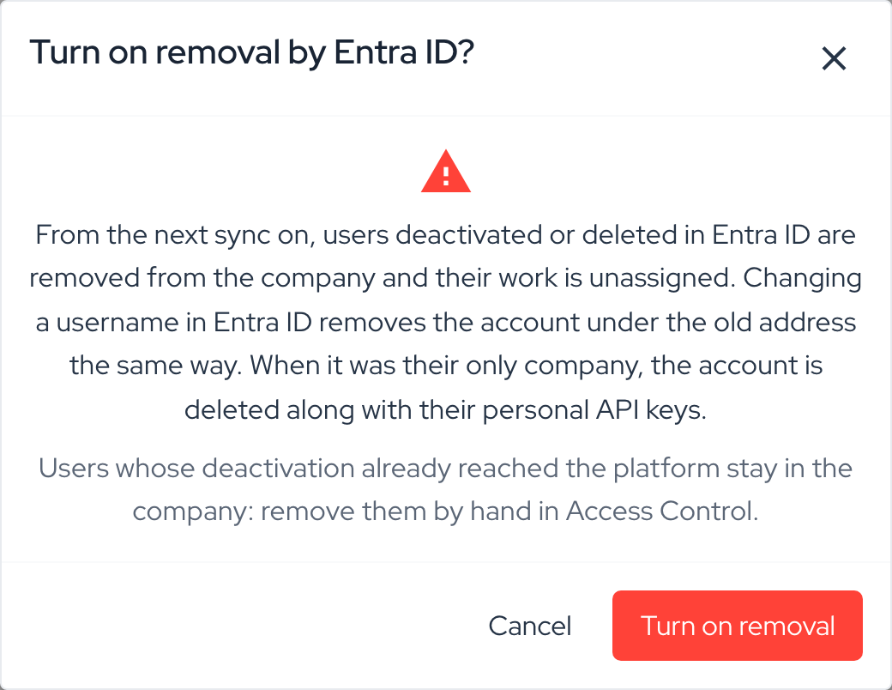

## Objective

Connect your identity provider to an SSO integration over SCIM 2.0, so the people of that integration stay up to date in Conviso Platform without waiting for their next SSO login. Provisioning keeps each person's name up to date. Depending on what you allow, it also decides their contact email, their mapped teams, their access profile, and whether they stay in the company.

The Conviso Platform side is the same for every identity provider, and it is described first. Each identity provider has its own section: [Microsoft Entra ID](#microsoft-entra-id), [Google Workspace](#google-workspace) and [Okta](#okta).

## What provisioning does and does not do {#what-provisioning-does}

- **It never creates an account.** An account is still created on the person's first SSO login or by an invitation. Provisioning describes the account whose login email is the `userName` your identity provider sends. A person who has no account yet is kept on the integration, and their account starts with what the identity provider sent once they log in for the first time.
- **It only accepts people in the integration's authorized domains.** A `userName` outside the **Authorized Domains** of the SSO integration is refused, and the identity provider gets a SCIM `400`. Authorize every domain your people sign in with before you start provisioning.
- **It never changes a login email.** When the identity provider changes a person's `userName`, the old address counts as a deactivation, and the person starts a new account on their next login.
- **It changes only what you allow.** As it comes, provisioning keeps names up to date and nothing else. Teams, access profiles, removal and the contact email each wait for you to [hand them over](#choose-what-the-identity-provider-decides).

## Prerequisites

- An **Entra ID**, **Google SSO** or **SAML 2.0** SSO integration, already saved.
- SCIM provisioning enabled for your company. Conviso enables it: ask our [support team](mailto:support@convisoappsec.com).
- To generate and manage the provisioning key: a company administrator, the role that manages service API keys.
- To change what the identity provider decides and to read the recent deliveries: a company administrator who also has permission to invite users.
- An identity provider that provisions over SCIM 2.0 with a Bearer token.

## Open the provisioning step {#open-the-step}

The **Provisioning (SCIM)** step is the last step of the SSO integration, marked **Optional**. It shows only while SCIM provisioning is enabled for the company, and only to company administrators. Everyone else, and every company without the feature, sees the integration end on **Role Mapping**.

1. In Conviso Platform, open **Integrations** > **Authentication** and open your **Entra ID**, **Google SSO** or **SAML 2.0** integration.
2. Select the **Provisioning (SCIM)** step title. You can also select **Confirm** on **Role Mapping**: it saves the mappings and opens this step.

Every action on this step is saved as you make it. **Done** closes the step without saving anything else.

## Generate the provisioning key {#generate-the-key}

The provisioning key is how your identity provider authenticates to Conviso Platform. Each SSO integration has one key. The company and the integration come from the key, never from the URL, so the **SCIM URL** is the same for every company.

1. Select **Generate key**.
2. In **Expires on**, pick when the key expires. It starts one year ahead. After that date, the platform refuses your identity provider with a `401` and provisioning stops.
3. Select **Generate key**.

4. Copy the **SCIM URL** and the **Token** into your identity provider, which sends the token as `Authorization: Bearer <token>`. The token is shown only once: paste it before you select **I've copied the token**.

:::caution Treat the token as a password
Anyone who has the token can change the people of this integration. Do not paste it into chat, email, or a ticket. If it leaks, regenerate the key.
:::

The key is a service API key named after the identity provider, such as **SCIM — Entra ID**. It is also listed in **Settings > API Keys**, where only its description can be edited.

### Keep the key valid {#keep-the-key-valid}

Once the token is copied, the step shows the key's status, when it was **Last used**, and when it **Expires**. **Last used** is the quickest way to tell whether your identity provider is reaching the platform.

- **Expiry.** The company administrators are warned 30, 15 and 7 days before the key expires, and on the day it expires. From 30 days out, the step also says when it expires. Regenerate the key before that date.
- **Regenerate** gives the key a new token and keeps its name and its link to the integration. The current token stops working right away, so paste the new one into your identity provider at once.
- **Revoke** stops provisioning: from the next sync on, the platform refuses your identity provider with a `401`. To resume, select **Generate new key** and paste the new token into your identity provider.

## Choose what the identity provider decides {#choose-what-the-identity-provider-decides}

Four settings on the step decide what provisioning may change. Only company administrators who also have permission to invite users can change them, and the info icon next to each one explains it on the screen.

| Setting | As it comes | Options |
| --- | --- | --- |
| **Where team membership comes from** | **SSO login** | **SSO login** or **Provisioning (SCIM)** |
| **Where access profiles come from** | **SSO login** | **SSO login** or **Provisioning (SCIM)** |
| **Let *identity provider* remove users from the company** | Off | On or off |
| **Let *identity provider* set the contact email** | Off | On or off |

On a **Google SSO** integration, the step shows only the last two. Team membership and access profiles keep coming from the SSO login there: see [Google Workspace](#google-workspace).

### Where team membership comes from {#teams-source}

- **SSO login**: every login applies the groups the identity provider sends in the SAML assertion, as described in each SSO guide under *Setup Group Mapping Integration*. Provisioning does not change teams.
- **Provisioning (SCIM)**: the groups the identity provider sends over SCIM apply as they arrive, between logins, and the SSO login ignores the groups it carries.

Either source applies the mappings of the **Group Mapping** step, and only while **Let *identity provider* decide team membership** is on in that step. Choosing **Provisioning (SCIM)** needs an active provisioning key and asks for confirmation.

Change the source only after your identity provider completes its first full provisioning cycle, groups included. SCIM cannot tell "no groups yet" from "no groups": until a person's groups arrive, their login takes them out of the mapped teams and unassigns the work only those teams covered.

Every mapped group must also be provisioned, with its people as direct members. The SSO login can carry groups that provisioning never sends, and a person in one of them leaves the teams mapped to that group. While provisioning is the source, the **Group Mapping** step says so.

### Where access profiles come from {#access-profiles-source}

- **SSO login**: every login applies the roles in the SAML assertion, as described in each SSO guide under *Setup Role Mapping Integration*. Provisioning does not change access profiles.
- **Provisioning (SCIM)**: the roles the identity provider sends over SCIM apply as they arrive, and the SSO login ignores the roles it carries.

Either source applies the mappings of the **Role Mapping** step, and only while **Let *identity provider* decide access profiles** is on in that step. Choosing **Provisioning (SCIM)** needs an active provisioning key and asks for confirmation. As with teams, change it only after the first full cycle.

With provisioning as the source, every mapped role must be sent over SCIM, not only in the SSO login. Once at least one role is mapped, a sync that declares none of the mapped roles for a person, or no role at all, sets that person to **viewer-only**. An access profile an administrator set by hand is not demoted.

Give each person one mapped role. When a person carries more than one, the access profile the identity provider already gave them stays while one of their roles still maps to it, so changing their profile means removing the old role in the identity provider. An access profile an administrator set by hand is replaced by the profile of the first mapped role the identity provider declares.

### Removal from the company {#removal}

**Let *identity provider* remove users from the company** is off as it comes.

- **Off**: nobody is removed. When the identity provider deactivates or deletes a person, or changes their username, the [recent deliveries](#recent-deliveries) show "Would remove *person* from the company". Read these entries before you turn removal on: they list who would leave.
- **On**: the same events remove the person from the company and unassign their work, as when an administrator removes them. When it was their only company, the account is deleted along with their personal API keys.

Turning removal on asks for confirmation, and it applies from the next sync on. People whose deactivation reached the platform before that stay in the company: remove them by hand in **Access Control**.

Some accounts are never removed, and the recent deliveries show them as "Did not remove *person* from the company", with the reason: the provisioning key's own account, an identity of the platform itself, and a user a service API key acts as. Revoke that service API key first.

Reactivating a person in the identity provider does not undo a removal in full. They get back only what the identity provider decides: their mapped teams and their access profile, by the sources above. Direct accesses and assignments do not come back.

### Contact email {#contact-email}

**Let *identity provider* set the contact email** is off as it comes. The contact email is where Conviso Platform sends a person's messages instead of their login email. It is described in [Contact email](sso-contact-email.md).

The identity provider declares it in a single attribute, `contactEmail`, from the extension `urn:ietf:params:scim:schemas:extension:conviso:2.0:User` that Conviso Platform announces. The `emails` list is not read. Each identity provider maps it its own way: see [Microsoft Entra ID](#entra-id-contact-email) and [Google Workspace](#google-workspace-contact-email).

- **Off**: provisioning writes no contact email, and each person can choose theirs in **My Profile**. A contact email the identity provider declared before stops applying, and until the person chooses one, their messages go to the login email.
- **On**: provisioned people can no longer choose their contact email. On the identity provider's next sync of each person, the address it declares in `contactEmail` becomes their contact email, replacing the one they chose. It receives every message, password reset links included. An address outside the integration's authorized domains and [contact email domains](sso-contact-email.md#which-addresses-are-accepted) is not applied: the account keeps the contact email it had, and the recent deliveries show "Did not apply the contact email of *person*".

An address equal to the login email counts as none. When the identity provider declares none, or declares the login email, the contact email it set before is dropped, and messages go to the login email. A contact email the person chose stays. The recent deliveries show "Set the contact email of *person* back to the login email", with the reason.

Turn it on before the first provisioning cycle. Turned on later, it reaches each person only the next time the identity provider writes them.

### When provisioning stops {#when-provisioning-stops}

While provisioning is the source of teams or access profiles, the SSO login ignores that part of the assertion. If provisioning stops, because the key expired or was revoked, or because SCIM provisioning was turned off for the company, those teams or profiles stop changing: the login does not take them back. Generate a new key, or move the source back to **SSO login**. If SCIM provisioning was turned off for the company, contact our [support team](mailto:support@convisoappsec.com).

## Recent deliveries {#recent-deliveries}

Select **View recent deliveries** on the step. The panel lists, newest first and for 90 days:

- every write the identity provider made to a user or a group;
- what provisioning changed in an account, with the old and new values: the name, the contact email, the access profile, and joining or leaving a mapped team;
- the people the identity provider removed, would remove, or did not remove, with the reason;
- the contact emails provisioning did not apply, with the address it received;
- the contact emails that went back to the login email, with the reason;
- every request that failed after its key was accepted, with the reason, the HTTP status and the SCIM error type.

Each delivery has a level: **Info** for a request that succeeded or a change to an account, **Warn** for something provisioning decided not to apply, and **Error** for a request that failed. Filter by **Level** and **Date**, or search by user, group, access profile or team.

A request made with an expired or revoked key leaves no delivery. Check the key's status on the step, and the provisioning logs of your identity provider, which show the `401`.

## Microsoft Entra ID {#microsoft-entra-id}

Entra ID provisions from a separate enterprise application, created only for SCIM. The gallery application **Conviso Platform SSO** you sign in with does not support provisioning, so it stays as it is.

### Before you start

- Entra ID SSO already works. See [Microsoft Entra ID SSO](microsoft-entra-id.md).
- Every domain your people sign in with is in the integration's **Authorized Domains**.
- You have the **SCIM URL** and the token from [Generate the provisioning key](#generate-the-key).
- You can sign in to the [Microsoft Entra admin center](https://entra.microsoft.com/) as at least a [Cloud Application Administrator](https://learn.microsoft.com/en-us/entra/identity/role-based-access-control/permissions-reference#cloud-application-administrator).

### Create the provisioning application

1. In the Microsoft Entra admin center, browse to **Entra ID** > **Enterprise apps** > **New application**.
2. Select **Create your own application**.
3. Enter a name, such as `Conviso Platform Provisioning`. Choose **Integrate any other application you don't find in the gallery (Non-gallery)** and create the application.

### Connect it to Conviso Platform

1. In the new application, select **Provisioning**, then **New configuration**.
2. In **Tenant URL**, paste the **SCIM URL**. In **Secret Token**, paste the token. Do not leave **Secret Token** empty.
3. Select **Test Connection**. When it succeeds, select **Create**.

### Assign users and groups

1. In the provisioning **Settings**, keep **Scope** at **Sync only assigned users and groups**. Only people and groups assigned to the application are provisioned.
2. In **Users and groups**, assign the people and groups to provision.
3. Assign each person to both applications: **Conviso Platform SSO** to sign in, and the provisioning application to be provisioned.
4. If team membership will come from provisioning, assign every group mapped in **Group Mapping**, with its people as direct members.

### Map the attributes

In **Attribute mapping**, open the mapping of users and check these rows, then **Save**:

| Entra ID attribute | SCIM attribute | What it does |
| --- | --- | --- |
| The attribute your SSO application sends in the `name` claim, usually `userPrincipalName` | `userName` | Finds the account by its login email |
| `mail` | `urn:ietf:params:scim:schemas:extension:conviso:2.0:User:contactEmail` | The contact email, when Entra ID sets it. Entra ID does not list this attribute until you add it: see [Send the contact email](#entra-id-contact-email) |
| `displayName`, `givenName`, `surname` | `displayName`, `name.givenName`, `name.familyName` | Keeps the name up to date |

Keep the rest of the default mapping, `active` included: it is how Entra ID deactivates a person. In the mapping of groups, keep `displayName`, `members`, and `objectId` to `externalId`. The group ID you typed in **Group Mapping** is that `objectId`.

:::caution Use the same attribute as the SSO claim
`userName` must carry the address the person logs in with. If it comes from another attribute than the `name` claim of [Conviso Platform SSO](microsoft-entra-id.md#email-field-mapping-in-saml-20-for-microsoft-entra-id), provisioning finds no account, or another one.
:::

### Send the contact email {#entra-id-contact-email}

As it comes, Entra ID maps `mail` to `emails[type eq "work"].value`, which Conviso Platform does not read. Send it to the contact email attribute instead:

1. In **Provisioning** > **Attribute mapping**, open the mapping of users. Under **Advanced Options**, edit the list of target user attributes and add an attribute named `urn:ietf:params:scim:schemas:extension:conviso:2.0:User:contactEmail`, of type `String`, with nothing checked. **Save**. Entra ID warns that the change starts a full sync.
2. Open the row of `mail`, change its **Target attribute** to the new attribute, and select **Apply**. **Save**.

Entra ID [skips an attribute that is empty](https://learn.microsoft.com/en-us/entra/identity/app-provisioning/known-issues#null-attribute-cant-be-provisioned). Clearing a person's `mail` sends nothing, so their contact email in Conviso Platform stays until `mail` carries another address.

### Send roles

Skip this section unless access profiles come from provisioning. While they do, only the roles assigned in the provisioning application count: the login ignores the roles of **Conviso Platform SSO**.

1. In **Entra ID** > **App registrations**, open the registration of the provisioning application. In **App roles**, create one role per access profile, for **Users/Groups**, with the same **Value** you mapped in **Role Mapping**.
2. In the provisioning application, open **Users and groups** and give each person, or each group, one of these roles.
3. In **Provisioning** > **Attribute mapping**, open the mapping of users. Under **Advanced Options**, edit the list of target user attributes and add an attribute named `roles`, of type `String`, with **Multi-value?** checked. If the list cannot be edited, open the portal at `https://portal.azure.com/?Microsoft_AAD_Connect_Provisioning_forceSchemaEditorEnabled=true`.
4. Add a mapping with **Mapping type** `Expression`, the expression `AssertiveAppRoleAssignmentsComplex([appRoleAssignments])`, **Target attribute** `roles`, applied **Always**. **Save**.

This expression does not work with the **Sync all users and groups** scope, which is one more reason to keep **Sync only assigned users and groups**. Microsoft describes it in [Provisioning a role to a SCIM app](https://learn.microsoft.com/en-us/entra/identity/app-provisioning/customize-application-attributes).

:::caution Do not use SingleAppRoleAssignment
Keep the `AssertiveAppRoleAssignmentsComplex` expression. With `SingleAppRoleAssignment`, Entra ID sends the role's display name instead of its **Value** when it updates a person. No role mapping matches it, and the person becomes **viewer-only**.
:::

### Turn on notifications and accidental deletion prevention

In the provisioning settings, enter a **Notification Email** and turn on accidental deletion prevention with a threshold. Entra ID writes to that address when provisioning goes into quarantine or crosses the threshold. The threshold counts deactivations too, so with removal on, it stops a mass unassignment from removing people from the company. See [Enable accidental deletions prevention](https://learn.microsoft.com/en-us/entra/identity/app-provisioning/accidental-deletions).

### Start provisioning

1. Optionally, check one person first with **Provision on demand**.
2. Select **Start provisioning**. The first cycle goes through every assigned person and group. After it, Entra ID runs a cycle about every 40 minutes, an interval that cannot be changed.
3. After you authorize a new domain, or add a contact email domain, select **Restart provisioning**. The people refused or not applied before are not retried on their own.

### Cautions

- **Authorize the domains before you turn provisioning on.** Everyone outside them is refused with a `400`.
- **Move team membership to provisioning only after the first full cycle has sent the groups.** Until a person's groups arrive, they leave the mapped teams.
- **Give each group a name no other group of the integration uses.** Entra ID allows two groups with the same display name, but the platform refuses the second with a `409`, and letter case does not tell two names apart. When two groups swap names, both keep being refused until one of them gets a temporary name first.
- **Give each person one mapped role.**
- **Read the "Would remove" deliveries before you turn removal on.**
- **Keep the key valid.** When most requests fail, an expired or revoked key included, Entra ID puts provisioning in quarantine: cycles drop to one a day, and after four weeks provisioning is turned off. Regenerate the key before it expires, paste the new token, and restart provisioning.
- **Changing a person's `userName` in Entra ID starts a new account.** The old address counts as a deactivation.

## Google Workspace {#google-workspace}

Google Workspace provisions from the custom SAML app your people already sign in with, so there is no second app. Google calls it autoprovisioning.

:::note Autoprovisioning is a Google beta
[Automated user provisioning with custom SCIM profiles](https://knowledge.workspace.google.com/admin/users/advanced/automated-user-provisioning-with-custom-scim-profiles) is a beta that Google opens only to some organizations. If the details page of your SAML app has no **Autoprovisioning**, Google has not enabled it for your organization yet.
:::

### What Google Workspace provisions {#google-workspace-provisions}

Google Workspace provisions people. It provisions no groups, and a role it sends is not used: see [Map the attributes](#google-workspace-attributes).

- **Names, removal and the contact email.** Google keeps each person's name up to date. When you allow it on the provisioning step, its deprovisioning [removes people from the company](#removal), and it [sets the contact email](#contact-email).
- **No teams.** The groups you choose in Google only decide who is provisioned, and Google never sends them. Team membership keeps coming from the SSO login, through the groups the SAML app sends, as described in [Setup Group Mapping Integration](google.md#setup-group-mapping-integration). The step of a Google SSO integration does not offer provisioning as the source of team membership.
- **No access profiles.** Access profiles keep coming from the SSO login, through the role the SAML app sends, as described in [Setup Role Mapping Integration](google.md#setup-role-mapping-integration). The step of a Google SSO integration does not offer provisioning as the source of access profiles.

### Before you start {#google-workspace-before-you-start}

- Google SSO already works, and the SAML app is turned on for the people to provision. See [Google SSO](google.md).
- Every domain your people sign in with is in the integration's **Authorized Domains**.
- You have the **SCIM URL** and the token from [Generate the provisioning key](#generate-the-key).
- You can sign in to the [Google Admin console](https://admin.google.com/) as a super administrator.

### Create the contact email attribute {#google-workspace-contact-email}

Skip this section unless Google Workspace will set the contact email. It has to come from a custom attribute of the Google Directory: **Primary email** is the login email, and an address equal to the login email counts as none.

1. In the Google Admin console, go to **Directory** > **Users**. At the top of the list, select **More options** > **Manage custom attributes**, then **Add Custom Attribute**.
2. Enter a **Category**, such as `Conviso`, and a custom field, such as `Contact email`, with **Info type** set to **Text** and **Number of values** set to **Single value**. Select **Add**. See [Create custom attributes for user profiles](https://knowledge.workspace.google.com/admin/users/create-custom-attributes-for-user-profiles).
3. For each person, open their account page, select **User information**, and fill in the attribute with their contact email.

When a person's attribute is empty, Google removes their contact email on its next sync: one it set before is dropped, and their messages go to the login email.

### Connect the SAML app to Conviso Platform {#google-workspace-connect}

1. In the Google Admin console, go to **Apps** > **Web and mobile apps** and open the SAML app your people sign in with, such as **Conviso Platform SSO**.
2. Under **Autoprovisioning**, select **Configure auto-provisioning**.
3. In **Access token**, paste the token, and select **Continue**.
4. In **Endpoint URL**, paste the **SCIM URL**, and select **Continue**. Google reads from Conviso Platform which attributes it accepts.

### Map the attributes {#google-workspace-attributes}

Google fills the app attributes from the SCIM user schema Conviso Platform announces, which lists more attributes than the platform reads. Check that each app attribute below comes from a Google Directory attribute, then select **Continue**.

| App attribute | What it does |
| --- | --- |
| `userName` | Finds the account by its login email. It must come from the attribute the SAML app sends as `email`, which the [Google SSO setup](google.md#google-web-app-setup) maps from **Primary email** |
| `displayName`, `name.givenName`, `name.familyName` | Keeps the name up to date: `displayName` when Google sends it, otherwise the given and family names together |
| `contactEmail` | The contact email, when Google Workspace sets it. It must come from the custom attribute of [Create the contact email attribute](#google-workspace-contact-email), never from **Primary email** |

:::caution Use the same attribute as the SSO login
`userName` must carry the address the person logs in with. If it comes from another attribute than the [`email` of the SAML app](google.md#email-field-mapping-in-saml-20), provisioning finds no account, or another one.
:::

The app attributes may include `roles`. A role mapped there changes nothing, because on a Google SSO integration access profiles come from the SSO login. They also include `emails`, which Conviso Platform does not read: the contact email comes only from `contactEmail`.

### Choose who is provisioned {#google-workspace-scope}

With no groups in the provisioning scope, Google provisions every person who has access to the SAML app. To provision only some of them, add their groups with **Search groups**.

These groups only choose who is provisioned. Google does not send them, so they put nobody in a team.

Google does not provision the people of a group who are in a secondary domain or outside your organization. Provisioning never updates them, and removal never reaches them.

### Choose how people are deprovisioned {#google-workspace-deprovisioning}

In the deprovisioning step, Google asks what to do with a person's account in the app, and when, for three events:

- **When an app is turned off for a user**
- **When a user is suspended from Google**
- **When a user is deleted from Google**

For each one, choose **Suspend user's account**, **Hard delete user's account** or both, and how long after the event Google sends it: **Within 24 hours**, or after 1, 7 or 21 days. Then select **Continue**.

Conviso Platform takes a suspension and a hard delete the same way, as a deactivation. What follows depends on **Let Google Workspace remove users from the company**, on the provisioning step:

- **Off**: nobody leaves the company. The delay only decides when the recent deliveries show "Would remove *person* from the company".
- **On**: the person leaves the company, and their work is unassigned, when the first of these requests arrives. With both actions chosen, the suspension comes first, because Google wants a longer delay before a hard delete, and the hard delete after it changes nothing more. See [Removal from the company](#removal).

While removal is on, the delay is how long the person stays in the company after the event. In that time, Google no longer lets them sign in through the SAML app, but they keep their teams, their access profile and their assigned work, and whatever does not go through the SSO login keeps working: their personal API keys and, unless **Allow login via SSO only** is on in the integration, a login with a password, which a password reset can also give them.

- **Within 24 hours**: they leave the company at most a day after the event.
- **After 1, 7 or 21 days**: they stay in the company for that long, then leave it.

Choose the delay your offboarding policy calls for.

### Test and activate autoprovisioning {#google-workspace-activate}

:::caution The test deletes the person it provisions
Google's test provisions a person, updates them and deletes them. With **Let Google Workspace remove users from the company** on, that deletion removes the person from the company. Run the test while removal is off, or with someone who is not in the company. With removal off and that person in the company, the recent deliveries then show "Would remove *person* from the company": the entry comes from the test.
:::

1. In the test step, choose in **Google Directory user** a person Google has not provisioned yet, and select **Test**. Each operation shows **Success**, **Failed** or **Not run**.
2. Select **Finish**. This saves the configuration, but it does not start provisioning.
3. On the details page of the SAML app, under **Autoprovisioning**, set the toggle to **Active**.

From then on, Google syncs every few hours.

:::note The test does not send the contact email
Google's test sends no custom attribute: the person it provisions has no `contactEmail`, and its update removes it. The contact email arrives only with the syncs, so check it in the recent deliveries after the first one.
:::

### Cautions {#google-workspace-cautions}

- **Authorize the domains before you turn autoprovisioning on.** Everyone outside them is refused with a `400`.
- **Run Google's test with removal off.** The test deletes the person it provisions.
- **Map `contactEmail` from a custom attribute, never from Primary email.** The primary email is the login email, which sets no contact email.
- **Check the contact email after a sync, not with Google's test.** The test sends no custom attribute.
- **Read the "Would remove" deliveries before you turn removal on.**
- **Give Google the new token when you regenerate the key.** Autoprovisioning stops while its token is expired or revoked. Under **Autoprovisioning**, select **App authorization** > **Reauthorize**, paste the new token into **Access token**, and select **Reauthorize**.
- **Changing a person's primary email in Google Workspace can start a new account.** When the `userName` Google sends changes, the old address counts as a deactivation.

## Okta {#okta}

Okta provisions from the SAML app your people already sign in with, so there is no second app. Once SCIM is on in that app, Okta pushes the people assigned to it, with their contact email and roles, and the groups you choose.

### Before you start {#okta-before-you-start}

- Okta SSO already works through a [SAML 2.0](saml.md) integration, from a SAML 2.0 app integration in Okta.
- Every domain your people sign in with is in the integration's **Authorized Domains**.
- You have the **SCIM URL** and the token from [Generate the provisioning key](#generate-the-key).
- You can sign in to the Okta Admin Console as a super administrator.

### Check the login email of the SAML app {#okta-login-email}

Okta sends each person's **Okta username** as the `userName`, which is how provisioning finds the account. The SAML app has to log them in with that same address, which Conviso Platform reads from the `email` attribute of the assertion.

1. In the Okta Admin Console, go to **Applications and Resources** > **Applications** and open the SAML app.
2. On the **Sign On** tab, under **Credentials Details**, check that **Application username format** is **Okta username**.
3. Under **Attribute statements**, check for an expression named `email` with the value `user.profile.login`. If there is none, select **Add expression**, enter `email` in **Name** and `user.profile.login` in **Expression**, and select **Save**. This syntax refuses `user.login`.

### Turn on SCIM in the SAML app {#okta-turn-on-scim}

1. In the SAML app, open the **General** tab and select **Edit** in **App Settings**.
2. In **Provisioning**, choose **SCIM**, and select **Save**. The **Provisioning** tab appears.

### Connect it to Conviso Platform {#okta-connect}

1. On the **Provisioning** tab, open **Integration** and select **Edit**.
2. Fill in the SCIM connection:
   - **SCIM connector base URL**: the **SCIM URL**.
   - **Unique identifier field for users**: `userName`.
   - **Supported provisioning actions**: check **Push New Users**, **Push Profile Updates** and **Push Groups**.
   - **Authentication Mode**: **HTTP Header**. In **Authorization**, paste only the token: Okta adds the `Bearer` prefix it shows before the box.
3. Select **Test Connector Configuration**, then **Save**.

The test only lists users. Passing it proves the URL and the token, not the attributes or the groups.

### Choose what Okta sends {#okta-to-app}

1. On the **Provisioning** tab, open **To App** and select **Edit**.
2. Enable **Create Users**, **Update User Attributes** and **Deactivate Users**, and select **Save**.

**Sync Password** is not needed. Okta sends a random password when it creates a person, even with it off, and Conviso Platform ignores it.

With **Deactivate Users** on, unassigning a person from the app and deactivating them in Okta both reach Conviso Platform as a deactivation: see [Removal from the company](#removal). Deleting the person in Okta afterwards sends nothing. Assigning again a person Okta already provisioned reaches Conviso Platform as a reactivation.

### Assign people {#okta-assign}

1. On the **Assignments** tab of the SAML app, select **Assign** > **Assign to People**.
2. Assign each person, check the attributes Okta shows, and select **Save and Go Back**. Then select **Done**.

Okta provisions each person when you assign them, and pushes the changes to their profile as you save them. You can also assign a group with **Assign to Groups**, but not a group you will push: see [Push groups](#okta-push-groups).

### Map the attributes {#okta-attributes}

Okta does not read the attributes Conviso Platform announces. The app profile Okta creates for SCIM already maps the name, and you add the contact email and the roles to it yourself.

| App attribute | What it does |
| --- | --- |
| `userName` | Finds the account by its login email. Okta fills it with the **Okta username**, the same address as the `email` attribute of the SAML app |
| `givenName`, `familyName`, `displayName` | Keeps the name up to date. Okta maps them from the Okta user profile as it comes |
| `contactEmail` | The contact email, when Okta sets it. You add it in [Send the contact email](#okta-contact-email) |
| `roles` | The roles, when access profiles come from provisioning. You add it in [Send roles](#okta-roles) |

The app profile also maps `email`, which Conviso Platform does not read: the contact email comes only from `contactEmail`.

### Send the contact email {#okta-contact-email}

Skip this section unless Okta will set the contact email. It has to come from an Okta user attribute other than the login: an address equal to the login email counts as none.

1. In the Okta Admin Console, go to **Directory** > **Profile Editor**, open the user profile of the SAML app, and select **Add Attribute**.
2. Fill in the attribute, and select **Save**:
   - **Data type**: `string`;
   - **Display name**: a name such as `Contact email`;
   - **Variable name** and **External name**: `contactEmail`;
   - **External namespace**: `urn:ietf:params:scim:schemas:extension:conviso:2.0:User`.
3. Select **Mappings**, and open the tab that maps the Okta user to the SAML app. In the row of `contactEmail`, enter the Okta user attribute that holds the contact email, such as `user.secondEmail`, and keep it applied on user create and update. Select **Save Mappings**.

When Okta offers to apply the new mapping, it sends it only to the people whose value changed.

When a person's attribute is empty, Okta sends an empty contact email: one it set before is dropped, and their messages go to the login email.

### Send roles {#okta-roles}

Skip this section unless access profiles come from provisioning. While they do, only the roles Okta provisions count: the login ignores the roles in the SAML assertion.

1. In **Directory** > **Profile Editor**, open the user profile of the SAML app and select **Add Attribute**.
2. Fill in the attribute, and select **Save**:
   - **Data type**: `string array`;
   - **Display name**: a name such as `Roles`;
   - **Variable name** and **External name**: `roles`;
   - **External namespace**: `urn:ietf:params:scim:schemas:core:2.0:User`.
3. Give each person their role, with the same value you mapped in **Role Mapping**: on the **Assignments** tab of the SAML app, edit the person and fill in **Roles**. To take it from the Okta user profile instead, map it in **Mappings**, as with the contact email.

**Roles** takes more than one value with **Add Another**, and each value is a role. Give each person one mapped role: see [Where access profiles come from](#access-profiles-source). A person whose **Roles** is empty declares no role.

### Push groups {#okta-push-groups}

Skip this section unless team membership comes from provisioning.

Okta sends no `externalId` with a group. The identifier you type in **Group Mapping** for a pushed group is its name in Okta, exactly as written.

1. Assign the group's people to the SAML app before you push it. Okta pushes only the members who are assigned to the app and already provisioned. Okta [does not support using the same group for app assignment and Group Push](https://help.okta.com/en-us/content/topics/users-groups-profiles/app-assignments-group-push.htm), so assign them one by one or through another group.
2. On the **Push Groups** tab, select **Push Groups** > **Find groups by name**, and enter the group's name. Keep **Push group memberships immediately** checked.
3. Okta looks the group up in Conviso Platform by its name. When there is none, the match result reads **No match found**, with **Create Group**. Select **Save**: Okta creates the group and pushes its members.
4. In Conviso Platform, on the **Group Mapping** step, map the team to the group's name in Okta.

From then on, Okta pushes each change of members and each new name as it happens. To rename a pushed group, change its identifier in **Group Mapping** to the new name first, then rename it in Okta right away: the rename gives its members the team again under the new name. In the other order, they leave the team until each of them signs in again.

### Cautions {#okta-cautions}

- **Authorize the domains before you assign people.** Everyone outside them is refused with a `400`.
- **Log in and provision with the same address.** Keep **Okta username** as the application username and `user.profile.login` in the `email` attribute statement.
- **Add `contactEmail` and `roles` to the app profile yourself.** Okta does not read the attributes Conviso Platform announces.
- **Map `contactEmail` from an attribute other than the login.** The login email sets no contact email.
- **Push every mapped group, and do not use it to assign the app.** Okta does not support the same group for both.
- **Move team membership to provisioning only after Okta has pushed the groups.** Until a person's groups arrive, they leave the mapped teams.
- **Moving a source to provisioning applies nothing at once.** A person's teams follow the next time their groups change or they log in, and their access profile the next time Okta writes them. Okta has no periodic cycle, and **Push now** on a group whose members did not change applies nothing.
- **Give each person one mapped role.**
- **Read the "Would remove" deliveries before you turn removal on.**
- **Give Okta the new token when you regenerate the key.** On the **Provisioning** tab, open **Integration**, select **Edit**, paste the new token into **Authorization**, and select **Save**.
- **Changing a person's Okta username can start a new account.** When the `userName` Okta sends changes, the old address counts as a deactivation.

## Validation

1. On the provisioning step, **Last used** shows a recent time.
2. In **View recent deliveries**, your identity provider created and updated the people in its scope.
3. Change the name of a test person in your identity provider. In Entra ID, use **Provision on demand**. Google Workspace sends it on its next sync, within a few hours. Okta sends it when you save the person's profile. A delivery reads "Changed the name of *person*", and their name in **Access Control** follows.
4. With **Let *identity provider* set the contact email** on, change the contact email of a test person the same way, to an address in an accepted domain. A delivery reads "Changed the contact email of *person*", and their **Contact email** in **Access Control** follows.

In Entra ID, the **Provisioning logs** of the provisioning application show every request and its result. In Google Workspace, open the SAML app in **Apps** > **Web and mobile apps**. Under **Autoprovisioning**, **View sync log** shows the events of each sync, and when there are failures, **Download list** gives each one with its reason.

## Troubleshooting

**The Provisioning (SCIM) step is missing.** SCIM provisioning is not enabled for the company, or you are not a company administrator.

**The SAML app has no Autoprovisioning in Google Workspace.** Google has not enabled its beta for your organization yet. If **Autoprovisioning** is there but cannot be turned on, the SAML app is not on for any user: turn it on in **User access**.

**Google's test fails on Create User.** Google already provisioned that person (`409`), their address is outside the integration's **Authorized Domains** (`400`), or **Access token** is not the current token (`401`).

**Test Connection fails in Entra ID.** Check that **Tenant URL** is the **SCIM URL** and that **Secret Token** is the current token. A regenerated, revoked or expired key is refused with a `401`.

**Test Connector Configuration fails in Okta.** Check that **SCIM connector base URL** is the **SCIM URL**, and that **Authorization** holds only the current token, without `Bearer`: Okta adds it.

**A person is refused with status 400.** Their `userName` is outside the integration's **Authorized Domains**. Authorize the domain, then restart provisioning in Entra ID. Google Workspace does not say when it retries a person it failed to provision: after its next sync, check under **Autoprovisioning**, with **Download list**, that the person is no longer among the failures.

**Teams do not change.** **Where team membership comes from** is still **SSO login**, or **Let *identity provider* decide team membership** is off. In Entra ID, the group is not assigned to the provisioning application, or its people are not direct members of it. In Okta, the group is not pushed, its people are not assigned to the SAML app, or the identifier in **Group Mapping** is not the group's name in Okta.

**A group is refused with status 409.** Another group of the same integration already has its display name, whatever the letter case, or its `externalId`. Rename one of them in the identity provider. When two groups swap names, give one a temporary name, wait for the next cycle, then give it the final name.

**Teams or access profiles do not change with Google Workspace.** On a Google SSO integration they come from the SSO login. Check the group and role mappings in the [Google SSO guide](google.md#setup-group-mapping-integration).

**People became viewer-only.** Access profiles come from provisioning, but the identity provider sends no mapped role. In Entra ID, check the [Send roles](#send-roles) steps, the expression of the `roles` mapping, and the role each person has in the provisioning application. In Okta, check the `roles` attribute of [Send roles](#okta-roles) and the **Roles** of each person's assignment.

**A contact email was not applied.** The address is outside the authorized domains and the contact email domains, or **Let *identity provider* set the contact email** is off.

**The contact email does not change.** In Entra ID, `mail` still goes to `emails[type eq "work"].value`, which Conviso Platform does not read: see [Send the contact email](#entra-id-contact-email). In Google Workspace, only the syncs send it, never the test. In Okta, check the **External namespace** of `contactEmail` in the app profile, and its mapping.

**The contact email went back to the login email.** The identity provider declared the login email, or no contact email: the delivery gives the reason. In Google Workspace, check that `contactEmail` comes from the custom attribute, not from **Primary email**, and that the person's attribute is filled in.

**Nobody changes any more.** The key expired or was revoked, or provisioning is in quarantine. Regenerate the key, paste the new token, and restart provisioning. In Google Workspace, paste it through **App authorization** > **Reauthorize**.

## Support

If you have any questions or need help using our product, please contact our [support team](mailto:support@convisoappsec.com).
