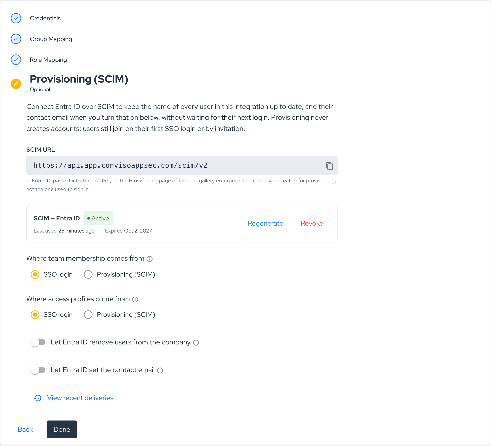
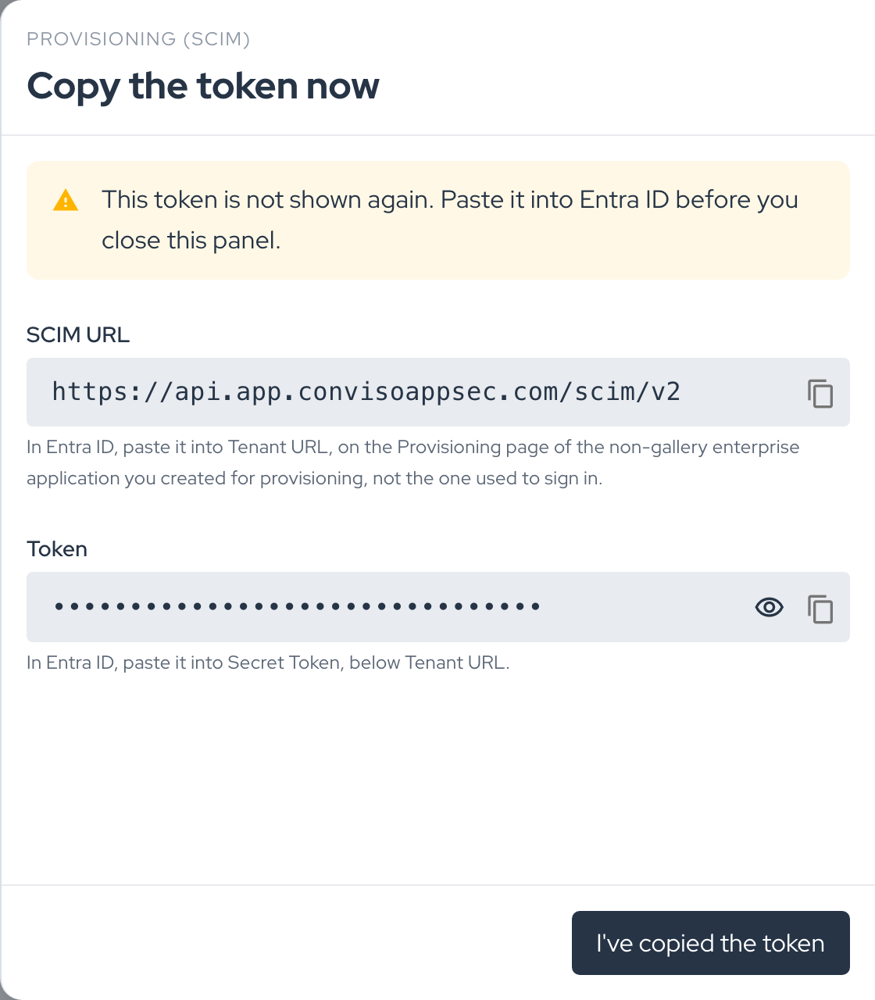
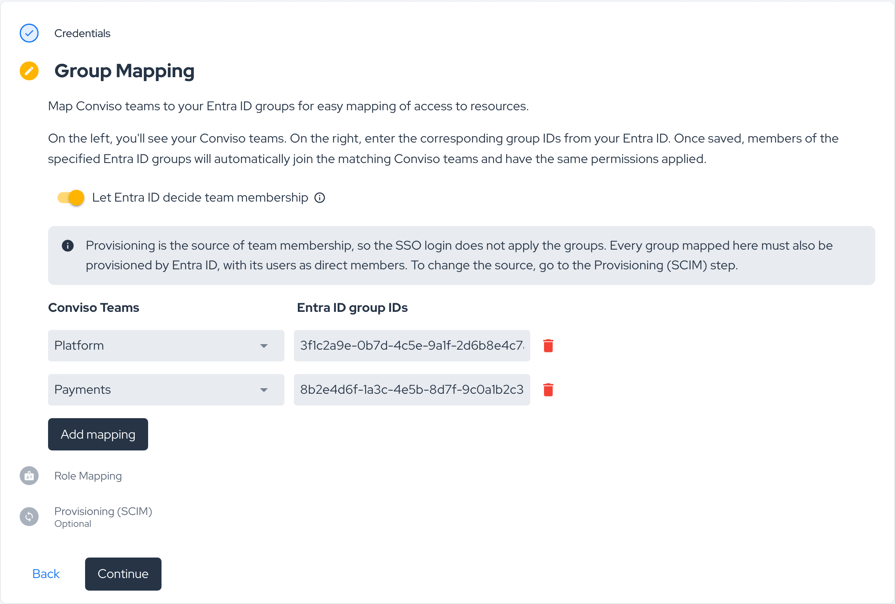
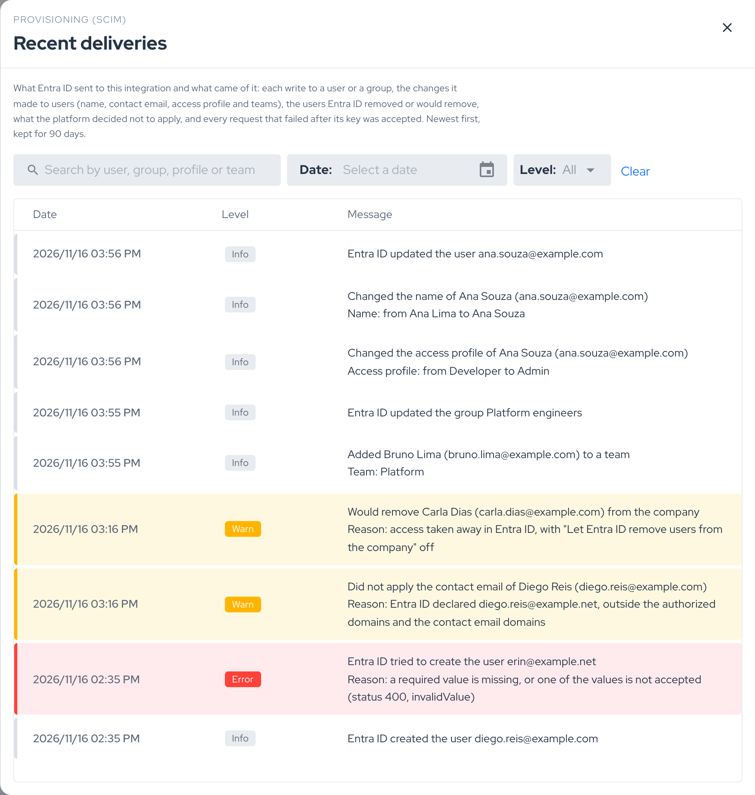

## Objective

Connect your identity provider to an SSO integration over SCIM 2.0, so the people of that integration stay up to date in Conviso Platform without waiting for their next SSO login. Provisioning keeps each person's name up to date. Depending on what you allow, it also decides their contact email, their mapped teams, their access profile, and whether they stay in the company.

The Conviso Platform side is the same for every identity provider, and it is described first. The identity provider side has its own section: [Microsoft Entra ID](#microsoft-entra-id).

## What provisioning does and does not do {#what-provisioning-does}

- **It never creates an account.** An account is still created on the person's first SSO login or by an invitation. Provisioning describes the account whose login email is the `userName` your identity provider sends. A person who has no account yet is kept on the integration, and their account starts with what the identity provider sent once they log in for the first time.
- **It only accepts people in the integration's authorized domains.** A `userName` outside the **Authorized Domains** of the SSO integration is refused, and the identity provider gets a SCIM `400`. Authorize every domain your people sign in with before you start provisioning.
- **It never changes a login email.** When the identity provider changes a person's `userName`, the old address counts as a deactivation, and the person starts a new account on their next login.
- **It changes only what you allow.** As it comes, provisioning keeps names up to date and nothing else. Teams, access profiles, removal and the contact email each wait for you to [hand them over](#choose-what-the-identity-provider-decides).

## Prerequisites

- An **Entra ID** or **SAML 2.0** SSO integration, already saved. The Google SSO integration has no provisioning step.
- SCIM provisioning enabled for your company. Conviso enables it: ask our [support team](mailto:support@convisoappsec.com).
- To generate and manage the provisioning key: a company administrator, the role that manages service API keys.
- To change what the identity provider decides and to read the recent deliveries: permission to invite users.
- An identity provider that provisions over SCIM 2.0 with a Bearer token.

## Open the provisioning step {#open-the-step}

The **Provisioning (SCIM)** step is the last step of the SSO integration, marked **Optional**. It shows only while SCIM provisioning is enabled for the company, and only to company administrators. Everyone else, and every company without the feature, sees the integration end on **Role Mapping**.

1. In Conviso Platform, open **Integrations** > **Authentication** and open your **Entra ID** or **SAML 2.0** integration.
2. Select the **Provisioning (SCIM)** step title. You can also select **Confirm** on **Role Mapping**: it saves the mappings and opens this step.

Every action on this step is saved as you make it. **Done** closes the step without saving anything else.

## Generate the provisioning key {#generate-the-key}

The provisioning key is how your identity provider authenticates to Conviso Platform. Each SSO integration has one key. The company and the integration come from the key, never from the URL, so the **SCIM URL** is the same for every company.

1. Select **Generate key**.
2. In **Expires on**, pick when the key expires. It starts one year ahead. After that date, the platform refuses your identity provider with a `401` and provisioning stops.
3. Select **Generate key**.

4. Copy the **SCIM URL** and the **Token** into your identity provider, which sends the token as `Authorization: Bearer <token>`. The token is shown only once: paste it before you select **I've copied the token**.

:::caution Treat the token as a password
Anyone who has the token can change the people of this integration. Do not paste it into chat, email, or a ticket. If it leaks, regenerate the key.
:::

The key is a service API key named after the identity provider, such as **SCIM — Entra ID**. It is also listed in **Settings > API Keys**, where only its description can be edited.

### Keep the key valid {#keep-the-key-valid}

Once the token is copied, the step shows the key's status, when it was **Last used**, and when it **Expires**. **Last used** is the quickest way to tell whether your identity provider is reaching the platform.

- **Expiry.** The company administrators are warned 30, 15 and 7 days before the key expires, and on the day it expires. From 30 days out, the step also says when it expires. Regenerate the key before that date.
- **Regenerate** gives the key a new token and keeps its name and its link to the integration. The current token stops working right away, so paste the new one into your identity provider at once.
- **Revoke** stops provisioning: from the next sync on, the platform refuses your identity provider with a `401`. To resume, select **Generate new key** and paste the new token into your identity provider.

## Choose what the identity provider decides {#choose-what-the-identity-provider-decides}

Four settings on the step decide what provisioning may change. Only users with permission to invite users can change them, and the info icon next to each one explains it on the screen.

| Setting | As it comes | Options |
| --- | --- | --- |
| **Where team membership comes from** | **SSO login** | **SSO login** or **Provisioning (SCIM)** |
| **Where access profiles come from** | **SSO login** | **SSO login** or **Provisioning (SCIM)** |
| **Let *identity provider* remove users from the company** | Off | On or off |
| **Let *identity provider* set the contact email** | Off | On or off |

### Where team membership comes from {#teams-source}

- **SSO login**: every login applies the groups the identity provider sends in the SAML assertion, as described in each SSO guide under *Setup Group Mapping Integration*. Provisioning does not change teams.
- **Provisioning (SCIM)**: the groups the identity provider sends over SCIM apply as they arrive, between logins, and the SSO login ignores the groups it carries.

Either source applies the mappings of the **Group Mapping** step, and only while **Let *identity provider* decide team membership** is on in that step. Choosing **Provisioning (SCIM)** needs an active provisioning key and asks for confirmation.

Change the source only after your identity provider completes its first full provisioning cycle, groups included. SCIM cannot tell "no groups yet" from "no groups": until a person's groups arrive, their login takes them out of the mapped teams and unassigns the work only those teams covered.

Every mapped group must also be provisioned, with its people as direct members. The SSO login can carry groups that provisioning never sends, and a person in one of them leaves the teams mapped to that group. While provisioning is the source, the **Group Mapping** step says so.

### Where access profiles come from {#access-profiles-source}

- **SSO login**: every login applies the roles in the SAML assertion, as described in each SSO guide under *Setup Role Mapping Integration*. Provisioning does not change access profiles.
- **Provisioning (SCIM)**: the roles the identity provider sends over SCIM apply as they arrive, and the SSO login ignores the roles it carries.

Either source applies the mappings of the **Role Mapping** step, and only while **Let *identity provider* decide access profiles** is on in that step. Choosing **Provisioning (SCIM)** needs an active provisioning key and asks for confirmation. As with teams, change it only after the first full cycle.

With provisioning as the source, every mapped role must be sent over SCIM, not only in the SSO login. Once at least one role is mapped, a sync that declares none of the mapped roles for a person, or no role at all, sets that person to **viewer-only**. An access profile an administrator set by hand is not demoted.

Give each person one mapped role. When a person carries more than one, the access profile they already have stays while its role is still declared, so changing their profile means removing the old role in the identity provider.

### Removal from the company {#removal}

**Let *identity provider* remove users from the company** is off as it comes.

- **Off**: nobody is removed. When the identity provider deactivates or deletes a person, or changes their username, the [recent deliveries](#recent-deliveries) show "Would remove *person* from the company". Read these entries before you turn removal on: they list who would leave.
- **On**: the same events remove the person from the company and unassign their work, as when an administrator removes them. When it was their only company, the account is deleted along with their personal API keys.

Turning removal on asks for confirmation, and it applies from the next sync on. People whose deactivation reached the platform before that stay in the company: remove them by hand in **Access Control**.

Some accounts are never removed, and the recent deliveries show them as "Did not remove *person* from the company", with the reason: the provisioning key's own account, an identity of the platform itself, and a user a service API key acts as. Revoke that service API key first.

Reactivating a person in the identity provider does not undo a removal in full. They get back only what the identity provider decides: their mapped teams and their access profile, by the sources above. Direct accesses and assignments do not come back.

### Contact email {#contact-email}

**Let *identity provider* set the contact email** is off as it comes. The contact email is where Conviso Platform sends a person's messages instead of their login email. It is described in [Contact email](sso-contact-email.md).

- **Off**: provisioning writes no contact email, and each person can choose theirs in **My Profile**. A contact email the identity provider declared before stops applying, and until the person chooses one, their messages go to the login email.
- **On**: provisioned people can no longer choose their contact email. On the identity provider's next sync of each person, the work email it declares becomes their contact email, replacing the one they chose. It receives every message, password reset links included. An address outside the integration's authorized domains and [contact email domains](sso-contact-email.md#which-addresses-are-accepted) is not applied: the account keeps the contact email it had, and the recent deliveries show "Did not apply the contact email of *person*".

Turn it on before the first provisioning cycle. Turned on later, it reaches each person only the next time the identity provider writes them.

### When provisioning stops {#when-provisioning-stops}

While provisioning is the source of teams or access profiles, the SSO login ignores that part of the assertion. If provisioning stops, because the key expired or was revoked, or because SCIM provisioning was turned off for the company, those teams or profiles stop changing: the login does not take them back. Generate a new key, or move the source back to **SSO login**. If SCIM provisioning was turned off for the company, contact our [support team](mailto:support@convisoappsec.com).

## Recent deliveries {#recent-deliveries}

Select **View recent deliveries** on the step. The panel lists, newest first and for 90 days:

- every write the identity provider made to a user or a group;
- what provisioning changed in an account, with the old and new values: the name, the contact email, the access profile, and joining or leaving a mapped team;
- the people the identity provider removed, would remove, or did not remove, with the reason;
- the contact emails provisioning did not apply, with the address it received;
- every request that failed after its key was accepted, with the reason, the HTTP status and the SCIM error type.

Each delivery has a level: **Info** for a request that succeeded or a change to an account, **Warn** for something provisioning decided not to apply, and **Error** for a request that failed. Filter by **Level** and **Date**, or search by user, group, access profile or team.

A request made with an expired or revoked key leaves no delivery. Check the key's status on the step, and the provisioning logs of your identity provider, which show the `401`.

## Microsoft Entra ID {#microsoft-entra-id}

Entra ID provisions from a separate enterprise application, created only for SCIM. The gallery application **Conviso Platform SSO** you sign in with does not support provisioning, so it stays as it is.

### Before you start

- Entra ID SSO already works. See [Microsoft Entra ID SSO](microsoft-entra-id.md).
- Every domain your people sign in with is in the integration's **Authorized Domains**.
- You have the **SCIM URL** and the token from [Generate the provisioning key](#generate-the-key).
- You can sign in to the [Microsoft Entra admin center](https://entra.microsoft.com/) as at least a [Cloud Application Administrator](https://learn.microsoft.com/en-us/entra/identity/role-based-access-control/permissions-reference#cloud-application-administrator).

### Create the provisioning application

1. In the Microsoft Entra admin center, browse to **Entra ID** > **Enterprise apps** > **New application**.
2. Select **Create your own application**.
3. Enter a name, such as `Conviso Platform Provisioning`. Choose **Integrate any other application you don't find in the gallery (Non-gallery)** and create the application.

### Connect it to Conviso Platform

1. In the new application, select **Provisioning**, then **New configuration**.
2. In **Tenant URL**, paste the **SCIM URL**. In **Secret Token**, paste the token. Do not leave **Secret Token** empty.
3. Select **Test Connection**. When it succeeds, select **Create**.

### Assign users and groups

1. In the provisioning **Settings**, keep **Scope** at **Sync only assigned users and groups**. Only people and groups assigned to the application are provisioned.
2. In **Users and groups**, assign the people and groups to provision.
3. Assign each person to both applications: **Conviso Platform SSO** to sign in, and the provisioning application to be provisioned.
4. If team membership will come from provisioning, assign every group mapped in **Group Mapping**, with its people as direct members.

### Map the attributes

In **Attribute mapping**, open the mapping of users and check these rows, then **Save**:

| Entra ID attribute | SCIM attribute | What it does |
| --- | --- | --- |
| The attribute your SSO application sends in the `name` claim, usually `userPrincipalName` | `userName` | Finds the account by its login email |
| `mail` | `emails[type eq "work"].value` | The work email, which becomes the contact email when Entra ID sets it |
| `displayName`, `givenName`, `surname` | `displayName`, `name.givenName`, `name.familyName` | Keeps the name up to date |

Keep the rest of the default mapping, `active` included: it is how Entra ID deactivates a person. In the mapping of groups, keep `displayName`, `members`, and `objectId` to `externalId`. The group ID you typed in **Group Mapping** is that `objectId`.

:::caution Use the same attribute as the SSO claim
`userName` must carry the address the person logs in with. If it comes from another attribute than the `name` claim of [Conviso Platform SSO](microsoft-entra-id.md#email-field-mapping-in-saml-20-for-microsoft-entra-id), provisioning finds no account, or another one.
:::

### Send roles

Skip this section unless access profiles come from provisioning. While they do, only the roles assigned in the provisioning application count: the login ignores the roles of **Conviso Platform SSO**.

1. In **Entra ID** > **App registrations**, open the registration of the provisioning application. In **App roles**, create one role per access profile, for **Users/Groups**, with the same **Value** you mapped in **Role Mapping**.
2. In the provisioning application, open **Users and groups** and give each person, or each group, one of these roles.
3. In **Provisioning** > **Attribute mapping**, open the mapping of users. Under **Advanced Options**, edit the list of target user attributes and add an attribute named `roles`, of type `String`, with **Multi-value?** checked. If the list cannot be edited, open the portal at `https://portal.azure.com/?Microsoft_AAD_Connect_Provisioning_forceSchemaEditorEnabled=true`.
4. Add a mapping with **Mapping type** `Expression`, the expression `AssertiveAppRoleAssignmentsComplex([appRoleAssignments])`, **Target attribute** `roles`, applied **Always**. **Save**.

This expression does not work with the **Sync all users and groups** scope, which is one more reason to keep **Sync only assigned users and groups**. Microsoft describes it in [Provisioning a role to a SCIM app](https://learn.microsoft.com/en-us/entra/identity/app-provisioning/customize-application-attributes).

:::caution Do not use SingleAppRoleAssignment
Keep the `AssertiveAppRoleAssignmentsComplex` expression. With `SingleAppRoleAssignment`, Entra ID sends the role's display name instead of its **Value** when it updates a person. No role mapping matches it, and the person becomes **viewer-only**.
:::

### Turn on notifications and accidental deletion prevention

In the provisioning settings, enter a **Notification Email** and turn on accidental deletion prevention with a threshold. Entra ID writes to that address when provisioning goes into quarantine or crosses the threshold. The threshold counts deactivations too, so with removal on, it stops a mass unassignment from removing people from the company. See [Enable accidental deletions prevention](https://learn.microsoft.com/en-us/entra/identity/app-provisioning/accidental-deletions).

### Start provisioning

1. Optionally, check one person first with **Provision on demand**.
2. Select **Start provisioning**. The first cycle goes through every assigned person and group. After it, Entra ID runs a cycle about every 40 minutes, an interval that cannot be changed.
3. After you authorize a new domain, or add a contact email domain, select **Restart provisioning**. The people refused or not applied before are not retried on their own.

### Cautions

- **Authorize the domains before you turn provisioning on.** Everyone outside them is refused with a `400`.
- **Move team membership to provisioning only after the first full cycle has sent the groups.** Until a person's groups arrive, they leave the mapped teams.
- **Give each group a name no other group of the integration uses.** Entra ID allows two groups with the same display name, but the platform refuses the second with a `409`, and letter case does not tell two names apart. When two groups swap names, both keep being refused until one of them gets a temporary name first.
- **Give each person one mapped role.**
- **Read the "Would remove" deliveries before you turn removal on.**
- **Keep the key valid.** When most requests fail, an expired or revoked key included, Entra ID puts provisioning in quarantine: cycles drop to one a day, and after four weeks provisioning is turned off. Regenerate the key before it expires, paste the new token, and restart provisioning.
- **Changing a person's `userName` in Entra ID starts a new account.** The old address counts as a deactivation.

## Validation

1. On the provisioning step, **Last used** shows a recent time.
2. In **View recent deliveries**, Entra ID created and updated the people you assigned.
3. Change the display name of a test person in Entra ID and use **Provision on demand**. A delivery reads "Changed the name of *person*", and their name in **Access Control** follows.

In Entra ID, the **Provisioning logs** of the provisioning application show every request and its result.

## Troubleshooting

**The Provisioning (SCIM) step is missing.** SCIM provisioning is not enabled for the company, you are not a company administrator, or the integration is Google SSO.

**Test Connection fails.** Check that **Tenant URL** is the **SCIM URL** and that **Secret Token** is the current token. A regenerated, revoked or expired key is refused with a `401`.

**A person is refused with status 400.** Their `userName` is outside the integration's **Authorized Domains**. Authorize the domain, then restart provisioning.

**Teams do not change.** **Where team membership comes from** is still **SSO login**, the group is not assigned to the provisioning application, the people are not direct members of it, or **Let Entra ID decide team membership** is off.

**A group is refused with status 409.** Another group of the same integration already has its display name, whatever the letter case, or its `externalId`. Rename one of them in the identity provider. When two groups swap names, give one a temporary name, wait for the next cycle, then give it the final name.

**People became viewer-only.** Access profiles come from provisioning, but Entra ID sends no mapped role. Check the **Send roles** steps, the expression of the `roles` mapping, and the role each person has in the provisioning application.

**A contact email was not applied.** The address is outside the authorized domains and the contact email domains, or **Let Entra ID set the contact email** is off.

**Nobody changes any more.** The key expired or was revoked, or provisioning is in quarantine. Regenerate the key, paste the new token, and restart provisioning.

## Support

If you have any questions or need help using our product, please contact our [support team](mailto:support@convisoappsec.com).
