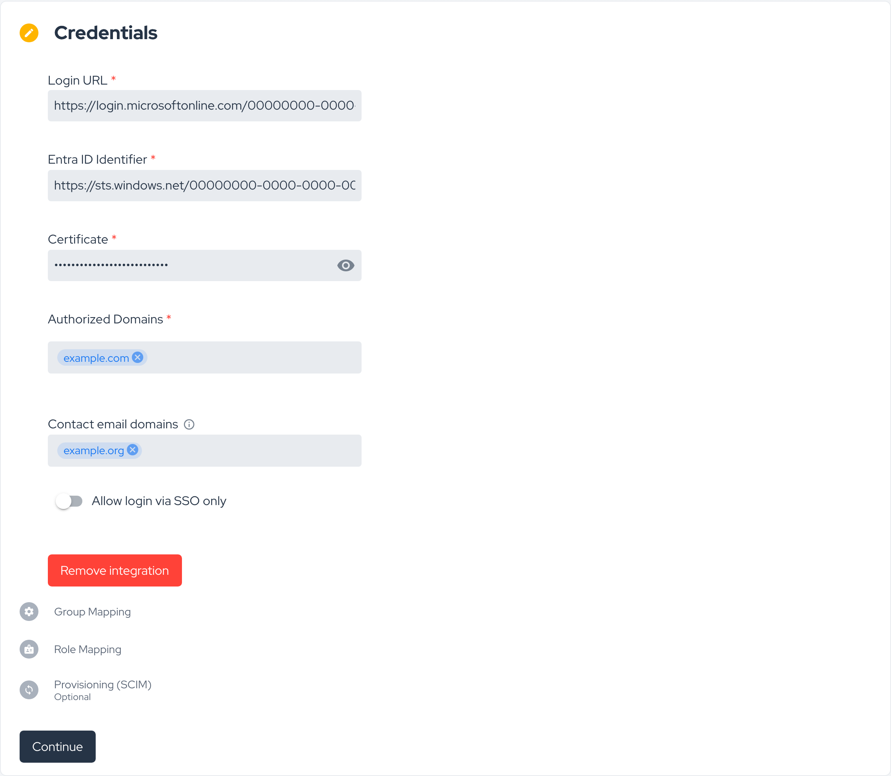
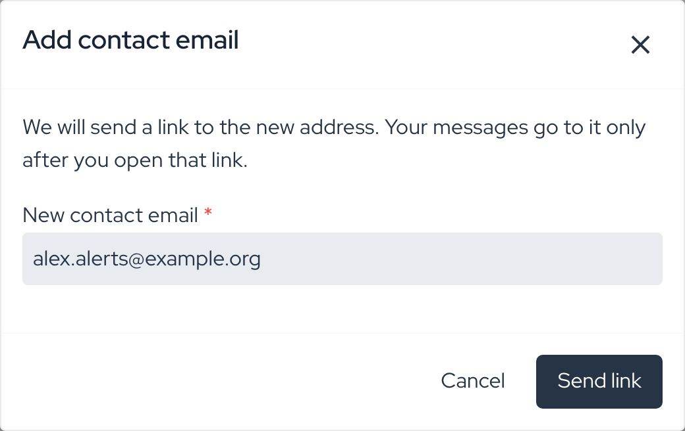
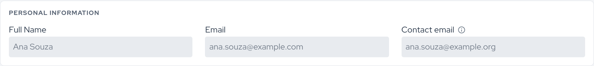

## Objective

A login email does not always have a mailbox. Microsoft Entra ID, for example, can sign people in with a `userPrincipalName` such as `name@company.onmicrosoft.com`, which receives nothing. The contact email is the address where Conviso Platform sends a person's messages instead of their login email. The login email does not change: the person keeps logging in with it.

The contact email works in every company with an SSO integration, whether **Microsoft Entra ID**, **Google** or **SAML 2.0**, with or without [SCIM provisioning](scim-provisioning.md). It comes from one of two places:

- **The person chooses it** in **My Profile** and confirms it through a link. See [Choose a contact email in My Profile](#choose-in-my-profile).
- **The identity provider declares it** over SCIM provisioning, when the SSO integration allows it. See [Let the identity provider set it](#identity-provider).

## Prerequisites

- An SSO integration, **Microsoft Entra ID**, **Google** or **SAML 2.0**, whose **Authorized Domains** include the person's login email.
- To change **Contact email domains**: permission to manage integrations.
- For the identity provider to declare the contact email: [SCIM provisioning](scim-provisioning.md) set up on that integration.

## Where messages go {#where-messages-go}

- With a contact email, messages go to it. Without one, they go to the login email.
- A contact email the person chose never receives a link that registers the account, sets its password or reactivates it. An invitation with a sign-up link, a password reset and an account reactivation are sent as if the person had no contact email. Everything else goes to the contact email.
- A contact email the identity provider declared receives every message, password reset links included.
- The address is checked again before every message. If the SSO integration stops accepting its domain, or stops letting the identity provider set the contact email, messages go back to the login email.

## Which addresses are accepted {#which-addresses-are-accepted}

A contact email has to be in a domain of the SSO integration that authorizes the person's login email:

- one of its **Authorized Domains**, which also decide who can log in; or
- one of its **Contact email domains**, which are accepted only for a contact email and never allow a login.

**Contact email domains** is on the **Credentials** step of every SSO integration. Each domain you add or remove is saved at once; **Continue** saves only the credentials. Only users who can manage integrations can change the list.

Public email providers, such as `gmail.com`, `outlook.com`, `hotmail.com` or `yahoo.com`, are refused. List only domains whose mailboxes belong to your company: the contact email can receive the company's messages, and a contact email the identity provider declares receives password resets.

## Choose a contact email in My Profile {#choose-in-my-profile}

The **Contact email** card shows in **My Profile** when the login email is in the **Authorized Domains** of an SSO integration. The exception is a person whose contact email the identity provider sets: one provisioned by an integration that lets the identity provider set it.

1. Open the profile menu at the top right and select **My Profile**.
2. In the **Contact email** card, select **Add**, or **Change** if there is one already.
3. Enter the **New contact email**. People who do not log in through SSO also confirm their **Current password**.
4. Select **Send link**.

5. Open the link sent to the new address. It works for 24 hours. Messages go to the new address only after the link is opened. Until then, the card shows the request as awaiting confirmation, and messages keep going where they went before.

While a request is pending, the card offers **Resend link**, which makes the previous link stop working, and **Cancel request**. **Remove** takes out a contact email the person chose, and messages go back to the login email. When a new address is confirmed or the contact email is removed, the address that stops receiving messages gets a notice.

A person can send up to five requests an hour. After that, no link is sent until the hour is over.

## Let the identity provider set it {#identity-provider}

With SCIM provisioning, the SSO integration can let the identity provider set the contact email: the switch **Let *identity provider* set the contact email**, on the **Provisioning (SCIM)** step, is off as it comes. See [Contact email](scim-provisioning.md#contact-email-authority) in the SCIM provisioning guide.

- **Off**: the identity provider's address is not used, and each person can choose theirs in **My Profile**.
- **On**: provisioned people can no longer choose. On the identity provider's next sync of each person, the work email it declares replaces the one they chose, as long as it is in an accepted domain. **My Profile** shows their contact email read only.

## See a user's contact email {#see-a-users-contact-email}

In **Access Control**, the page of a user shows their **Contact email** next to the login **Email**, read only. The info icon says where it came from: the identity provider or the user themselves. Nobody can set another person's contact email.

## Validation

1. After opening the confirmation link, the **Contact email** card in **My Profile** shows the new address, with no request awaiting confirmation.
2. An administrator sees the same address as the **Contact email** on the person's page in **Access Control**.
3. The next platform message, such as a notification, arrives at the new address.

## Troubleshooting

**The Contact email card is missing in My Profile.** The login email's domain is not in the **Authorized Domains** of any SSO integration, or the person is provisioned by an integration that lets the identity provider set the contact email.

**"This address is outside the domains your company accepts for a contact email."** The address is not in the integration's authorized or contact email domains. Ask someone who manages integrations to add its domain to **Contact email domains**.

**"Public email providers cannot be contact email domains."** The domain belongs to a public email provider and cannot be added.

**The confirmation link does not work.** It expired after 24 hours, a newer link replaced it, or the request was cancelled. Request the address again.

**A message went to the login email.** The link was not opened yet, the address's domain is no longer accepted, or the message was an invitation with a sign-up link, a password reset or an account reactivation, which never go to an address the person chose.

## Support

If you have any questions or need help using our product, please contact our [support team](mailto:support@convisoappsec.com).
