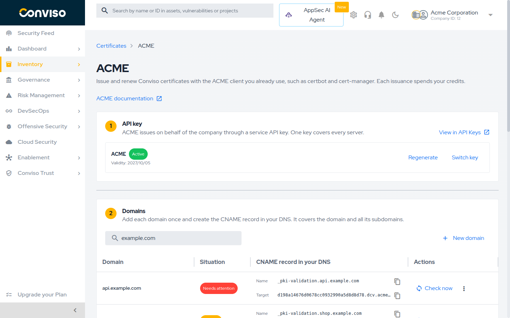
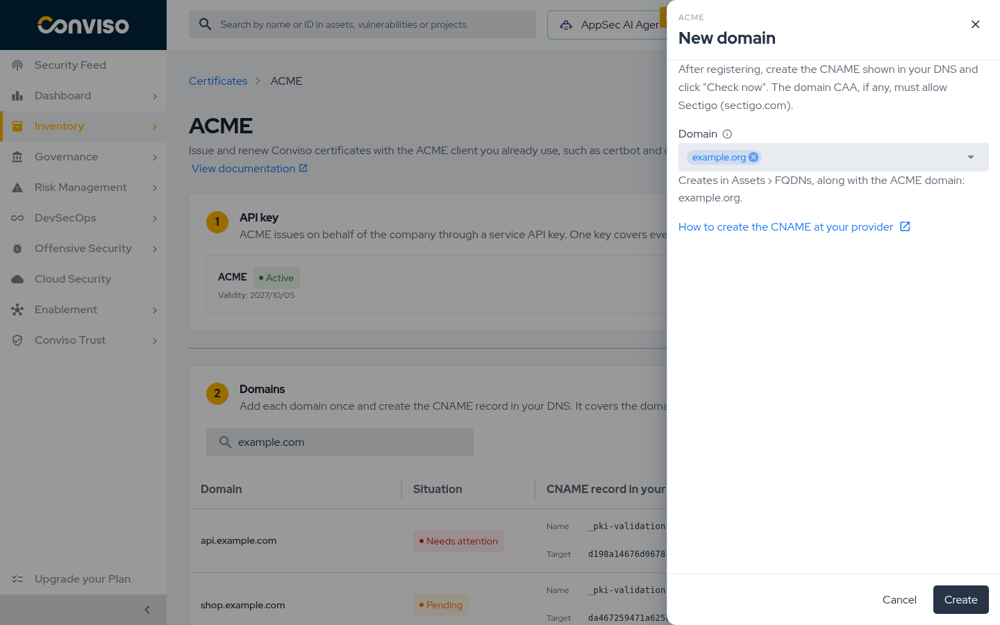
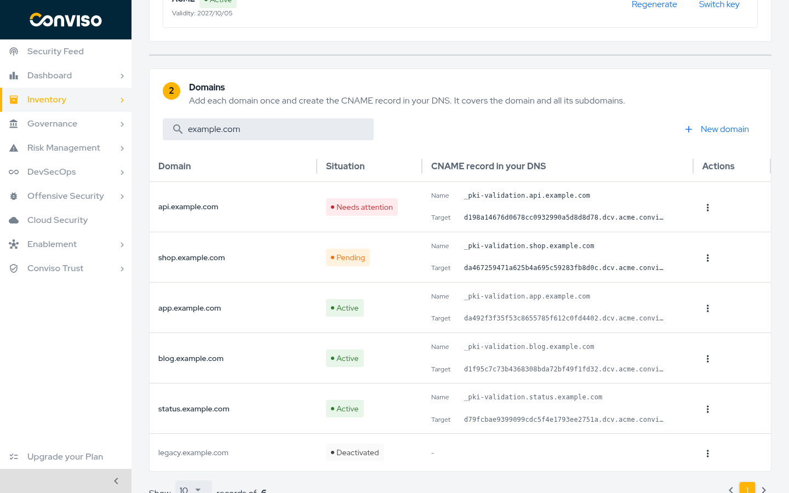
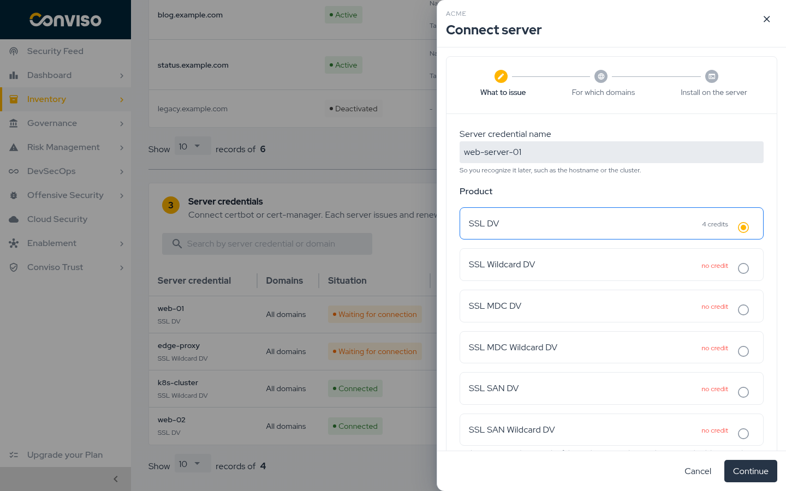

:::note Draft
This page is a work in progress.
:::

## Objective

Issue and renew Conviso SSL/TLS certificates with the ACME client you already run, such as
**certbot** or **cert-manager**, without opening the platform for each certificate. You prove
control of each domain once, connect each server once, and from then on the client orders and
renews certificates on its own. Each new certificate spends a credit, exactly like one issued from
the portal; renewals reuse it while its term lasts (see [Renewal](#renewal)).

## How It Works

1. **Create the ACME API key.** ACME issues on behalf of your company through one service API key,
   created on the ACME page by a company administrator. See [The ACME API Key](#acme-api-key).
2. **Verify the domain.** Add the domain on the ACME page and create one CNAME record in your DNS.
   It is done once and covers the domain and all of its subdomains, wildcard included.
3. **Connect the server.** Create a server credential: choose the product, optionally limit the
   domains, and copy the key into certbot or cert-manager.
4. **Certificates come out on their own.** The client orders the certificate, the platform issues
   it with your credit, and the client renews it before it expires.

No challenge is answered per order: the CNAME you created in step 2 is what proves control of the
domain for every order that follows.

## Prerequisites

* The SSL Certificates module enabled for your account and permission to manage certificates. See
  [Before You Start](./ssl-certificates.md#before-you-start).
* A company administrator for the first step: only administrators select, create, regenerate or
  switch the ACME API key.
* Credits for a **DV** product (SSL DV, SSL Wildcard DV, SSL MDC DV, SSL MDC Wildcard DV, SSL SAN DV
  or SSL SAN Wildcard DV). OV and EV are not issued through ACME. See
  [Certificate Credits](./ssl-certificates.md#certificate-credits).
* Access to create records in the DNS of the domain.
* Two-factor authentication enabled on your user account (or sign-in through your company's SSO)
  to create server credentials and edit their domains. See [Connect a Server](#connect-a-server).
* An ACME client that supports External Account Binding (EAB), such as certbot or cert-manager.

## The ACME Page {#the-acme-page}

The ACME page is under **Inventory > Assets > Certificates**: click **Configure ACME** in the
certificate list toolbar. The page follows the order of the setup, top to bottom:

1. **API key:** the service API key ACME issues through, with its validity and profile.
2. **Domains:** the domains of your company and the CNAME record each one needs.
3. **Server credentials:** the servers and clusters connected to ACME, with their situation.

Until the API key exists, the Domains and Server credentials sections stay locked. The Domains
and Server credentials sections are lists with their own search and their own action: **New
domain** and **Connect server**. While no domain is verified, the Server credentials section warns
that servers only issue after a domain is verified. The **ACME documentation** link at the top of the
page opens this guide.



## The ACME API Key {#acme-api-key}

ACME issues certificates on behalf of your company through one **Service** API key of your account.
You create it in the **API key** section, the first step of the ACME page, and it is also listed
with your other keys under **Settings > API Keys**. Every server credential of the company runs
through this one key.

### Create the Key {#create-acme-key}

1. In the **API key** section, click **Select or create API key**.
2. To use an existing service key, pick it from the list and click **Use this key**. To create one,
   click **New API key**.
3. In the API key form, keep the suggested name (**ACME**, or **ACME 2** and so on if the name is
   taken) or type another. It must be unique among the company's service keys.
4. Choose the **Expiration date**. One year is suggested.
5. Pick at least one team in **Teams**, or turn on **Grant access to all company resources** under
   **Access Control**; the form requires one of them. This choice does not limit what ACME issues:
   ACME is authorized by the key's profile, **SSL ACME Service**.
6. Click **Create key** and copy the token shown. It is shown only once. ACME starts using the new
   key right away.

The key gets the **SSL ACME Service** profile, which allows reading and managing certificates and
nothing else. Keep this profile on the key: with another profile, issuance fails.

ACME does not use the token: your servers keep the EAB of each server credential. The token gives
access to the company's certificate REST API, so keep it as a secret or discard it.

### Keep the Key Valid {#keep-acme-key-valid}

From 30 days before the expiry date, the API key section warns that the key is about to expire.
Click **Regenerate** and choose a new validity. Regenerating creates a new version of the same key
with a new token, shown once; servers, server credentials and accounts stay as they are and nothing
changes in certbot or cert-manager. When the key expires, ACME stops for the whole company until it
is regenerated.

### Switch to Another Key {#switch-acme-key}

**Switch key** lists every service API key of the company and marks which ones have the **SSL ACME
Service** profile. Pick one that has the profile and is within its validity: every server credential
moves to it, and nothing changes on the servers. Keys without the profile cannot be picked; change
their profile under **Settings > API Keys** first, after checking that they are not used by another
integration. Personal keys are not listed.

The previous key is not revoked. It stays active under **Settings > API Keys**; revoke it there if
it is no longer used.

### If the Key Is Revoked {#acme-key-revoked}

Revoking the ACME key stops ACME for the whole company: new orders and renewals are refused until
there is an active key. Certificates already issued stay valid until they expire. A revoked key
cannot be regenerated: click **Create new key** or **Switch key** in the API key section. Servers
start issuing again without any change on their side.

The API key step is for company administrators only, as service keys are in **Settings > API Keys**:
selecting, creating, regenerating and switching the key. Other users, including those who manage
certificates, see the key, its validity and the warnings, and are asked to contact the company
administrator.

## Add a Domain {#add-a-domain}

1. In the **Domains** section, click **New domain**.
2. Pick the domain from the company's FQDNs, or type the registered domain, for example
   `example.com`, and press **Enter**. Adding `example.com` already covers `www.example.com`,
   `app.example.com` and `*.example.com`; there is no need to add subdomains one by one. Several
   domains can be added at once.
3. Click **Create**. The domain appears as **Pending**, with the CNAME record to create. A typed
   domain that is not in Assets yet is also created there as an FQDN, which needs permission to
   create assets.



## Create the CNAME Record {#create-the-cname-record}

Each domain shows the record to create in your DNS:

| Field | Value |
|---|---|
| Type | `CNAME` |
| Name | `_pki-validation.<your domain>`, for example `_pki-validation.example.com` |
| Target | `d48e2ff2023f18696cb8f0a0ff9c4635.dcv.acme.conviso.com.br` (example; copy the value shown on the page, unique for each domain) |

{/* TODO: confirm the production zone (dcv.acme.conviso.com.br is a placeholder until infra
defines it). */}

After creating the record, open the menu (**⋮**) on the domain's row and click **Check now**. When
the platform finds the CNAME, the domain turns **Active** and servers can issue for it.

Keep the record in place. The platform checks every active domain once a day; if the record is
removed or changed, the domain turns **Needs attention**, new orders for it are refused and the
users who can see the company's certificates are notified. Once the record is fixed, the domain
turns **Active** again on the next daily check, or right away with **Check now**. A DNS
server that does not answer once does not change the domain; if it still does not answer on a check
12 hours or more later, the domain turns **Needs attention** as well. A certificate that stops
renewing because of it is covered by the usual expiration warnings.

If the domain has CAA records, they must allow Sectigo (`sectigo.com`), the certificate authority
that issues Conviso certificates.



### Common DNS Providers {#dns-providers}

Most providers ask for the name **without** the domain at the end. For `example.com`, type
`_pki-validation` in the name field and paste the target as the value.

{/* TODO: short notes per provider (Route 53, Cloudflare, registro.br, GoDaddy) after checking
each provider's current screen. */}

## CNAME Troubleshooting {#cname-troubleshooting}

When **Check now** does not find the record, a new domain stays **Pending** and an active domain
turns **Needs attention**; hover over the situation to see the reason. The usual causes:

* **Record created under the wrong name.** Some providers append the domain automatically, which
  produces `_pki-validation.example.com.example.com`. Use only `_pki-validation` in the name field.
* **Record not propagated yet.** DNS changes can take a few minutes to become visible, depending on
  the TTL. Wait and click **Check now** again.
* **Proxy enabled.** In providers that offer a proxy (such as Cloudflare), the CNAME must be
  **DNS only**.
* **CAA does not allow Sectigo.** Add a CAA record with `0 issue "sectigo.com"` next to your
  existing ones. If the domain also has `issuewild` records, add `0 issuewild "sectigo.com"` as
  well for wildcard certificates.
* **Domain marked as Needs attention after working.** The daily check stopped finding the CNAME,
  the CAA now refuses Sectigo, or your DNS servers stopped answering. Fix the record or the DNS
  service and click **Check now**.

## Deactivating a Domain {#deactivating-a-domain}

Open the menu (**⋮**) on the domain's row and click **Deactivate**. The dialog asks you to type
`DEACTIVATE` to confirm and warns that reactivating the domain later needs a new CNAME.

Deactivating a domain refuses new orders for it; certificates already issued stay valid. Delete
its `_pki-validation` CNAME from your DNS as well: until you do, the domain stays delegated to
Conviso.

To use a deactivated domain again, click **Reactivate** in the menu (**⋮**) of its row. It goes back
to **Pending** with a new CNAME target: create the new CNAME in your DNS (in place of the old one,
if it is still there) and click **Check now**. The old CNAME no longer validates the domain.
Registering the same name again under **New domain** is refused while the deactivated one exists;
reactivate it instead.

## Names Each Product Accepts {#names-per-product}

Besides the CNAME, an order is refused when its names do not fit the product of the server
credential:

| Product | Names in one order |
|---|---|
| SSL DV | One name, optionally with its `www.` form. The certificate always carries both, for example `example.com` and `www.example.com`. |
| SSL Wildcard DV | `*.example.com`, optionally with `example.com`. The certificate always carries both. |
| SSL MDC DV, SSL SAN DV | Several names. |
| SSL MDC Wildcard DV, SSL SAN Wildcard DV | Several names, including `*.` names. |

Names that do not fit are refused with `rejectedIdentifier`; for example, `certbot -d a.example.com
-d b.example.com` on an SSL DV server credential. An order with more names than any credit of the
product holds is refused with a message such as `no credit of SSL MDC DV holds 3 names`; when no
credit of the product is available, the message is `no available credit of SSL MDC DV`.

## Connect a Server {#connect-a-server}

A **server credential** connects one server or cluster. Create one per server so you can follow
and switch off each of them on its own.

1. In the **Server credentials** section, click **Connect server**.
2. **What to issue:** name the credential (the hostname or the cluster, for example) and choose
   the product. The product decides the certificate type; each issuance spends one credit of it.
   Connecting a server needs a usable ACME API key; see [The ACME API Key](#acme-api-key).
3. **For which domains:** optionally limit the domains this server may order. With none selected,
   it covers every verified domain of the company, including domains verified later. You can
   change it later with **Edit domains**. Click **Generate key** to create the server credential.
4. **Install on the server:** copy the **Directory URL**, the **EAB Key ID** and the
   **EAB HMAC Key**, and use them in the client as shown below.

:::info Two-factor sign-in
To create a server credential, edit its domains or generate an EAB, your user account must have
two-factor authentication enabled, or you must sign in through your company's SSO. Without it, the
platform refuses the request with "Managing ACME credentials and EABs requires signing in to the
portal with two-factor authentication". Requests made with an API key cannot do it either. Company administrators are notified each time an EAB is generated.
:::

:::danger The key is shown only once
The EAB HMAC Key cannot be displayed again after the panel is closed. It works for **one**
registration and expires after **7 days**. If it is lost or expires, use **Generate new EAB** on
the server credential.
:::

The panel waits for the server and shows when it connects; you can also close it and follow the
situation in the list. The credential shows **Waiting for connection** until the client
registers with the key, and **Connected** after that. A link to this guide sits right below the
key warning, for the step-by-step setup.



### certbot {#certbot}

Request the first certificate with the values copied from the panel:

```bash
certbot certonly --standalone \
  --server <Directory URL> \
  --eab-kid <EAB Key ID> \
  --eab-hmac-key <EAB HMAC Key> \
  --issuance-timeout 300 \
  -d example.com
```

* Issuance is asynchronous and usually takes a few minutes, but an order can stay in processing for
  up to 2 hours before it fails. certbot waits 90 seconds by default; `--issuance-timeout 300`
  gives it more room. If certbot gives up waiting, the order keeps going on the platform: wait for
  the certificate to show up in the certificate list before running the command again. Each run
  creates a new private key, and a run made while the first order is still processing spends
  another credit, or is refused when there is none.
* `--standalone` is there only because certbot asks for an authenticator. The authorizations come
  back already valid, since the domain was verified once through the CNAME, so certbot runs no
  challenge and does not need port 80. It works on a server that already uses that port.
* For a wildcard, quote the name: `-d '*.example.com'`.
* certbot registers the account on this first run. Later runs on the same server reuse it, so the
  EAB key is not needed again.
* Renewal uses certbot's own scheduler (systemd timer or cron, installed with certbot). Check that
  it is in place with `systemctl list-timers | grep certbot` or in the crontab. Do not test it with
  `certbot renew --dry-run`: against the Conviso server the dry run is not simulated, it reissues
  the certificate for real.

### cert-manager {#cert-manager}

Store the HMAC key in a Secret and create a `ClusterIssuer` pointing to the Directory URL. The
issuer needs **no solvers**, because orders come back already authorized:

```bash
kubectl -n cert-manager create secret generic conviso-acme-eab \
  --from-literal=hmac=<EAB HMAC Key>
```

```yaml
apiVersion: cert-manager.io/v1
kind: ClusterIssuer
metadata:
  name: conviso-acme
spec:
  acme:
    server: <Directory URL>
    privateKeySecretRef:
      name: conviso-acme-account
    externalAccountBinding:
      keyID: <EAB Key ID>
      keySecretRef:
        name: conviso-acme-eab
        key: hmac
```

Then request certificates as usual:

```yaml
apiVersion: cert-manager.io/v1
kind: Certificate
metadata:
  name: app
spec:
  secretName: app-tls
  dnsNames:
    - app.example.com
  issuerRef:
    name: conviso-acme
    kind: ClusterIssuer
```

The product is set by the server credential, so a cluster that needs two products (for example
SSL DV and SSL Wildcard DV) uses two server credentials and two `ClusterIssuer` resources.
cert-manager renews the certificate on its own before it expires.

### Other ACME Clients {#other-clients}

Any client with External Account Binding support works with the same three values: the Directory
URL as the ACME server, the EAB Key ID and the EAB HMAC Key.

{/* TODO: tested examples for acme.sh, Caddy, Traefik and win-acme. */}

## Renewal {#renewal}

The client renews on its own; nothing is done in the platform. A renewal of the same names reuses
the credit of the original certificate while that credit's term lasts. Such a renewal is a reissue:
the new certificate shows up in the certificate list and the previous one moves to **Replaced**, as
in [Renewing with Reissue](./managing-certificates.md#renewing-with-reissue). A certificate can be
reissued up to 10 times in 24 hours; past that, the client is told to retry later. After the term ends, or
when the names change, the next issuance spends a new credit. Only certificates issued through ACME
are renewed this way: the first ACME issuance always spends a credit, even for names that already
have a certificate bought in the platform. Without an available credit for the
server credential's product, the order is refused and the client reports an authorization error.

In the last 30 days of a credit's term, a renewal spends a new credit when one is available. The
certificate authority ends a renewal with the term, so a certificate renewed then would expire
with it and the client would renew it again on every run. Without an available credit, the
renewal still uses the original credit and expires when its term ends.

A single-domain certificate always covers both `example.com` and `www.example.com`, so ordering
either one renews the same certificate. The renewal keeps the main name of the first issuance: if
the first certificate was ordered for `example.com`, a renewal ordered for `www.example.com` still
comes out with `example.com` as its main name, and covers both. Changing the main name would make
the certificate authority revoke the copies already installed on your other servers.

If an order fails after the certificate was bought, for example because the CNAME was fixed more than
two hours later, the next order for the same names continues that purchase without spending another
credit, even when the client creates a new private key. If the certificate authority refuses to
continue it, the order spends an available credit instead. If the certificate authority does not
answer, or cannot take the order at that moment, the order fails with "the certificate authority did
not answer; place the order again" or "the certificate authority could not take the order now; place
the order again later": run the client again, and the next order continues the same purchase.

If the certificate authority never confirmed a purchase, new orders for those names are refused until
the platform checks that purchase with the certificate authority, which happens automatically within
two hours: the purchase either continues or its credit becomes available again. Then order again. If
the purchase is still not settled after a week, its certificate turns to Error and the names take
orders again, spending a new credit; contact Conviso Support about the credit of that purchase. A
scheduled `certbot renew` and cert-manager retry a failed renewal on their own; a first issuance with
`certbot certonly` has to be run again.

## Revoking a Certificate {#revoking}

A certificate issued through ACME can be revoked by:

* the ACME account that issued it, usually from the client that requested it:

  ```bash
  certbot revoke --cert-name example.com --reason superseded
  ```

* another ACME account of the company, when its server credential may order every name in the
  certificate and each name is under an active domain. Certificates bought in the platform are not
  reachable this way; revoke them in the platform.
* a request signed with the certificate's own private key, from any machine that holds it:

  ```bash
  certbot revoke --server <Directory URL> \
    --cert-path /path/to/cert.pem --key-path /path/to/privkey.pem
  ```

The accepted reasons are `unspecified`, `keycompromise`, `affiliationchanged`, `superseded` and
`cessationofoperation`.

## Managing Server Credentials {#managing-server-credentials}

The **Server credentials** list shows, for each credential: the product, the domains it may
order (**All domains** when not limited), the situation, the number of **Active accounts**, the
number of **Unused EABs** and the **Last issuance**. Click the active accounts count to see the
accounts. The actions of each row:

* **Generate new EAB:** a new key for a server that lost the previous one, or for a new
  installation.
* **Edit domains:** change which domains the server may order. Renewals for domains removed from
  the list are refused from the next order on.
* **Accounts:** each installation that registered with a key creates an ACME account. Deactivate an
  account to switch off one installation without touching the others. A deactivated account cannot
  be used again: to reconnect that installation, register a new ACME account, with a new account
  key and a new EAB.
* **Deactivate:** switches the server credential off for good. Its accounts stop on their next
  request and its unused keys stop working. Certificates already issued stay valid until they
  expire.

## FAQ {#faq}

{/* TODO: questions collected from the team and from support. */}
