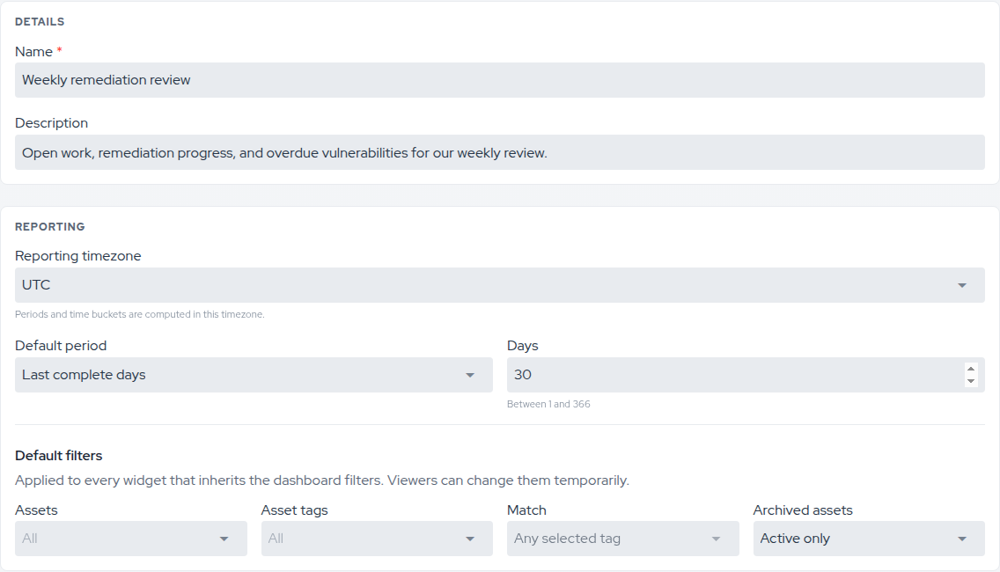
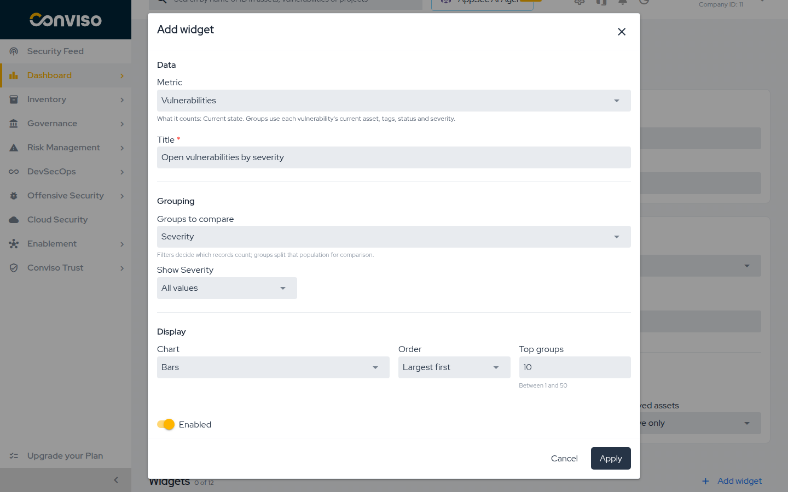
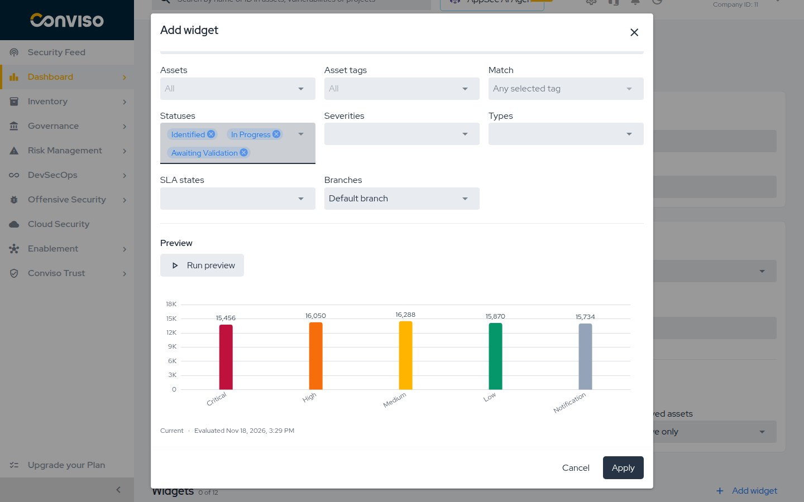

Create a metric that helps your team decide where to focus remediation. This guide measures **open vulnerabilities by severity**, defines which work is included, and saves the metric in a **Weekly remediation review** collection.

You can then add metrics for backlog, remediation speed, and deadline compliance to assess both the work remaining and the progress made.

## Before you start

You need permission to manage your own Metrics Studio collections and access to the vulnerabilities you want to measure. To change an existing collection, you need edit access to it.

For a ready-made starting point, [install a metric pack](./metrics-studio.md#quick-start-use-a-metric-pack) and edit one of its collections.

## 1. Define the management question

Start with: **How much open work do we have at each severity?** This metric will help the team compare the remaining work and decide which vulnerabilities need attention.

Create a collection to save this metric and the related indicators you will use in the same review:

1. Open **Dashboard > Metrics Studio**.
2. If a favorite opens, select **Metrics Studio** in the breadcrumb at the top of the page to return to the list.
3. Select **New**.
4. In **Name**, enter `Weekly remediation review`.
5. In **Description**, enter `Open work, remediation progress, and overdue vulnerabilities for our weekly review.`

Give the collection a name that tells colleagues why they should open it. The description is a good place to explain its audience and intended scope.

## 2. Define the reporting scope

1. In **Reporting timezone**, choose the timezone used by your team.
2. In **Default period**, select **Last complete days**.
3. Set **Days** to `30`.
4. In **Default filters**, select the assets or asset tags for your review. Leave these empty to use all assets available within your access.
5. Check **Archived assets** and choose whether the review should include them.

These settings give the collection a repeatable starting point. The reporting timezone determines calendar boundaries for periods and time buckets. A **time bucket** is one interval on a trend chart, such as a day or week.

For example, 30 complete days excludes the current, unfinished day. [Period options](./explore-metrics.md#choose-the-period) explains how to include today or use fixed dates.

*Step 2: The saved reporting settings define the period, timezone, and asset scope used when someone opens the collection.*

## 3. Create the metric

Use **Add widget** to configure the metric and how its result is presented:

1. Select **Add widget**.
2. In **Metric**, search for and select **Vulnerabilities**.
3. Read **What it counts**. This metric measures the current state, so the selected reporting period does not turn it into a historical count.
4. In **Title**, enter `Open vulnerabilities by severity`.
5. In **Groups to compare**, select **Severity**.
6. Keep **Show Severity** set to **All values**.
7. In **Chart**, select **Bars**.
8. Under **Widget filters**, set **Statuses** to **Identified**, **In Progress**, and **Awaiting Validation**.
9. Keep **Dashboard filters** set to **Apply dashboard filters too**.

Selecting open statuses matters: **Vulnerabilities** has no automatic restriction to open work. Without the status filter, the chart can include fixed or accepted vulnerabilities too. See [Workflow Status](../../vulnerability-management/workflow-status.md) for status definitions.

*Step 3: The editor explains the selected metric and lets you compare all severity groups in a bar chart. Scroll down to set the widget filters.*

Keep **Branches** set to **Default branch** for this example. Choose **All branches** when your review should include vulnerabilities across branches, and use the same branch scope when comparing results with a vulnerability list.

### Understand filters and groups

**Filters** decide which records are counted. **Groups** divide those records for comparison.

In this example, the status filter selects open work and the severity grouping splits that work into Critical, High, Medium, Low, and Notification. If the collection also filters by an asset tag, the widget counts only matching open vulnerabilities within your access.

**Selected values only** limits which groups are displayed. Use **Widget filters** when you want to change the population being measured.

## 4. Validate the metric

1. Select **Run preview**.
2. Check that the preview shows the expected severity groups and numbers, or an understandable **No data** result.
3. Adjust the filters or chart if needed.
4. Select **Apply** to add the widget to your draft.

*Step 4: The preview shows the current vulnerability count for the selected open statuses, split by severity. Apply adds this configuration to the draft.*

:::important Save the complete collection
**Run preview** calculates a result without saving anything. **Apply** updates the widget in your draft. Select **Save** on the main editor page to keep the collection and its widgets.
:::

## 5. Add metrics for progress and commitments

Pair the open-work metric with indicators that support management decisions. Backlog shows the work remaining, remediation time helps assess delivery speed, and SLA metrics show whether deadlines are being met. Keep the initial collection focused on the questions your team reviews regularly.

| Question | Metric to select | Suggested presentation | What to check |
| --- | --- | --- | --- |
| Is the backlog improving? | **Historical backlog** | **Line** | Use weekly time buckets for a longer period; the metric defaults to open statuses. |
| How quickly do we fix vulnerabilities? | **Mean time to remediate** | **Number**, with no grouping | Only completed remediation cycles contribute to the average. |
| Are fixes meeting deadlines? | **Fixed within SLA** | **Number**, with no grouping | Fixes without an SLA deadline are reported separately. |
| Which deadlines need attention? | **SLA state** | **Table**, grouped by **SLA state** | This describes current SLA state, even when the collection has a reporting period. |

Choose the metric first, then select from the grouping and chart options the editor offers. The available options depend on the metric and selected grouping.

### Choose how to present the result

Use the format that makes the metric easiest to interpret. A single number can support a headline review, a table can support comparisons, and a trend can help assess progress over time.

| Chart | Best for |
| --- | --- |
| **Number** | One headline value, such as an average or total. |
| **Table** | Comparing exact values across named groups. |
| **Bars** or **Horizontal bars** | Comparing categories such as severities, assets, or tags. |
| **Stacked bars** | Comparing groups with a second breakdown, when supported. |
| **Line** | Seeing how a metric changes over time. |

## 6. Save the metrics for your review

1. Put headline values first and supporting charts after them.
2. Use each widget's **Size** control to choose a suitable width.
3. Use **Move earlier** and **Move later** to adjust the reading order.
4. Use **Edit widget** to refine a metric or **Remove widget** to remove it from the draft.
5. Select **Save**.

The **Enabled** control lets you retain a widget's configuration while disabling its calculation. A disabled widget is not a zero result.

## Confirm it worked

1. Reopen the collection from the Metrics Studio list.
2. Check that the name, widgets, and layout were saved.
3. Confirm the reporting settings match your intended defaults.
4. For the open-vulnerability widget, compare a supported linked value with its underlying records. The status and asset scope should match.

You now have a defined measurement that your team can use in recurring reviews. Continue with [Explore and understand your metrics](./explore-metrics.md), or [share the metrics](./share-and-reuse.md) with the people responsible for acting on them.

## Troubleshooting

| What happens | What to do |
| --- | --- |
| A chart or grouping is unavailable. | Select an option offered for the current metric. Changing the grouping can change the available charts. |
| A widget reports invalid configuration. | Reopen it, review the fields marked for attention, and run the preview again. |
| The preview worked, but the widget is missing after reopening. | Apply the widget, then save the complete collection before leaving the editor. |
| A daily trend takes too long or exceeds its supported period. | Shorten the period or choose weekly or monthly time buckets. Daily snapshots support at most 92 days. |
| The collection was saved elsewhere while you were editing. | Use **Load the latest version** and review the conflict options before discarding or keeping your changes on top of it. |
| The widget or collection limit is reached. | Follow the limit shown by the platform. Remove content you no longer need or reuse an existing collection. |
