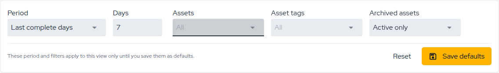
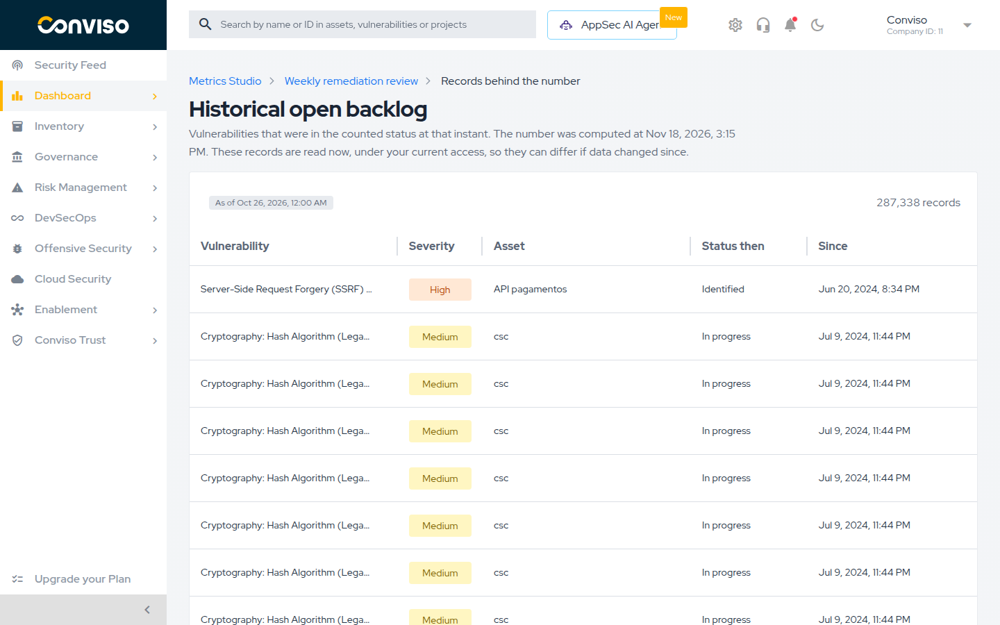

Use Metrics Studio to move from a headline number to an informed decision. This guide explains how to choose the reporting scope, interpret different kinds of metrics, and inspect the records behind a result.

## Before you start

Open a saved collection you own or one that has been shared with you. You can explore its period and filters with viewing access. Saving defaults or changing widgets requires edit access.

## Choose the period

Use **Period** to choose the reporting window. Date boundaries follow the collection's **Reporting timezone**.

| Option | What it includes | When to use it |
| --- | --- | --- |
| **Last complete days** | The selected number of full days before today. | Compare completed reporting days without today's partial results. |
| **Last days including today** | A rolling window that includes the current day. | Include today's activity in an operational review. |
| **Fixed dates** | An inclusive start and end date. | Review a particular month, release, or incident window. |

For example, on November 18, **Last complete days** with `7` covers November 11–17. **Last days including today** with `7` covers November 12–18, including the partial current day. The date is determined in the reporting timezone.

Periods can span at most 366 days. Some metrics have narrower limits for daily snapshots; use weekly points for a longer trend when the widget reports this limit.

## Focus on the right assets

1. Find the filter bar above the widgets.
2. Select specific **Assets**, **Asset tags**, or both.
3. For multiple tags, choose **Any selected tag** or **All selected tags**.
4. Choose whether **Archived assets** includes active assets, archived assets, or both.
5. Review the updated results.

**Any selected tag** includes assets matching at least one selected tag. **All selected tags** requires an asset to match every selected tag.

### Understand which settings apply

There are three places that can affect a widget's result:

| Setting | Effect |
| --- | --- |
| Saved defaults | The starting period and filters when the collection opens. |
| Current viewing settings | Temporary changes made while exploring the collection. |
| Widget settings | Additional filters, an independent period, or a choice to use only that widget's filters. |

With **Apply dashboard filters too**, widget filters further narrow the selected scope. For example, a collection limited to the Payments assets and a widget limited to Critical severity counts Critical vulnerabilities in Payments.

With **Use only this widget's filters**, the widget does not use the collection's asset filters. A widget with **Use its own period** also keeps its separate reporting window. These options are useful for reference metrics, but check them when a tile appears not to follow your selections.

## Keep a useful starting point

- Select **Save defaults**, when available, to save the current period and filters for future visits. On a shared collection, other users also start from these saved settings.
- Select **Reset** to return to the saved period and filters.
- Select **Refresh** to calculate the results again.

Changing viewing settings does not save them automatically. A viewer can investigate a different scope without changing the shared starting settings.

*Changing the period reveals a notice that the selection is temporary. Reset restores the saved settings; Save defaults keeps the new starting settings for the collection.*

## Understand what a number measures

Open **About this data** on a widget to check its measurement details, evaluation time, and any notes about the result. When editing a widget, read **What it counts** before choosing it.

The reporting period has different effects depending on the metric:

| Metric behavior | Example | How to read it |
| --- | --- | --- |
| **Current** | Vulnerabilities or SLA state | The state now. Changing the period does not change it into a historical metric. |
| Events within a period | Vulnerabilities recorded or completed remediation cycles | Activity during the selected reporting window. |
| **Snapshot at each bucket end** | Historical backlog | The state at the end of each day, week, or month. |

For example, a count of currently fixed vulnerabilities and a count of fixes completed this month answer different questions. Check the metric explanation before comparing them.

### Read totals and percentages carefully

- **Overlapping groups:** An asset can have several tags. A vulnerability can therefore appear in more than one tag group. Those group values may not add up to the total; the widget displays an overlap note when applicable.
- **Top groups:** A widget limited to the largest groups may leave other groups outside the chart. Check the notice before treating the visible rows as the complete population.
- **Percentages:** Compare the samples and denominators as well as the rate. Do not add percentages across teams to calculate a company rate.
- **Missing samples:** No completed fixes means there may be no average remediation time. **No data** does not mean remediation time is zero.
- **Historical classification:** Read the notes on historical metrics. Some use today's severity, ownership, tags, or group membership when showing past activity.

## Open the records behind a result

When a result supports investigation, select **Open records** below a number, a chart value, or a linked table value. Metrics Studio opens either a filtered vulnerability list or a records page, identified by the **Records behind the number** breadcrumb.

1. Select the value you want to investigate.
2. Check the selected group and, when shown, the period or **As of** time.
3. Review the vulnerabilities, remediation cycles, or asset scores that support the metric.
4. Return to the saved collection using the page navigation.

Only supported values provide a link. Some calculated values cannot be represented by a matching record list.

Records are read when you open them, under your current access. They can differ from a previously calculated number if the data or your access changed. Refresh the collection and open the value again when you need a current comparison.

*Step 3: Selecting a historical backlog point opens the contributing vulnerabilities, including their status at the selected instant and when that status began.*

## Return to a favorite

1. Open the Metrics Studio list using the **Metrics Studio** breadcrumb.
2. Find the collection you use most often.
3. Select its star in the **Favorite** column.
4. Open **Metrics Studio** from the left menu again.

Your favorite opens directly. Use the collection selector to switch to another saved collection, or the **Metrics Studio** breadcrumb to return to the list.

You can keep one favorite per company for your user in the current browser. This preference does not synchronize across browsers or devices, and it does not change anyone else's favorite.

## Confirm your interpretation

Before using a result in a meeting or report, check the metric's meaning, scope, reporting timezone, date rules, and evaluation time. For a supported value, inspect the records behind it to confirm the result represents the question you intend to answer.

## Widget messages

| Message | Meaning and next step |
| --- | --- |
| **No data** | There are no samples for this metric and scope. Check the filters, period, and source data. |
| **No access to this data** | Your account cannot read the underlying dataset. Ask your administrator to review your data access. |
| **Unavailable** | The source cannot answer this configuration. Read the reason shown; some company-wide metrics require visibility across all active assets. |
| **Invalid configuration** | The saved widget does not match the current catalog. Ask an editor to review and preview it. |
| **Could not compute** or **Request failed** | Select **Refresh**. If it continues, record the metric, scope, and error for support. |
| **Took too long** | Narrow the period or scope. For trends, try larger time buckets. |
| **Disabled** | The widget is retained but is not being calculated. An editor can enable it. |
| **Dashboard changed** | Reload the collection to use the latest saved version. |
| **Unavailable references (still applied)** | Some saved selections cannot be resolved for your account. They still restrict the result. Ask an editor to review the saved filters. |

If a supporting-record link expires or the collection changes, return to the collection and open the value again. Send colleagues the saved collection's link so they can investigate with their own access.
