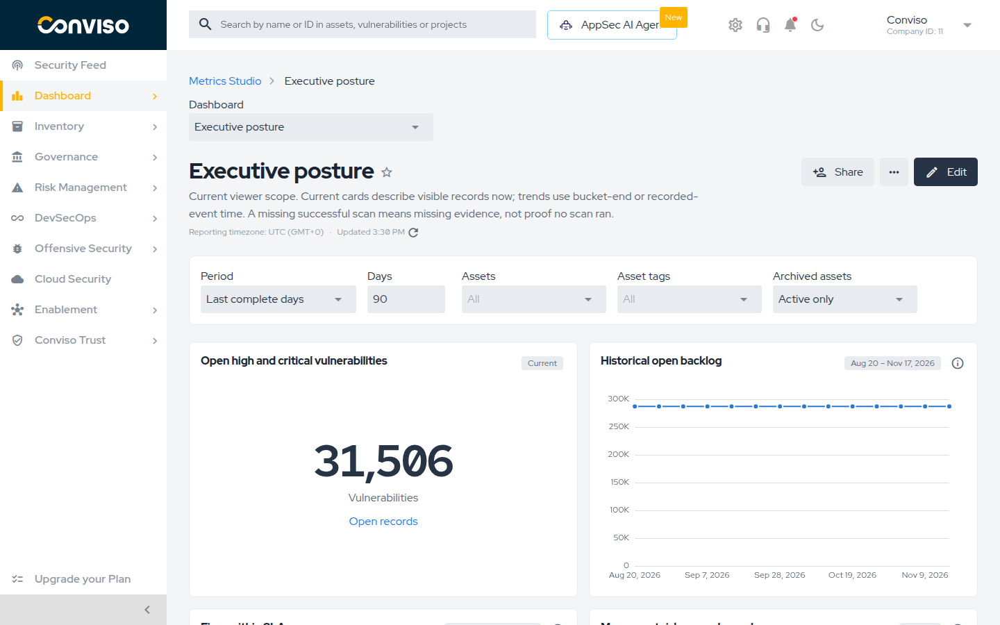
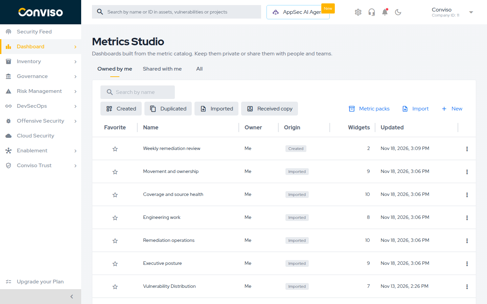
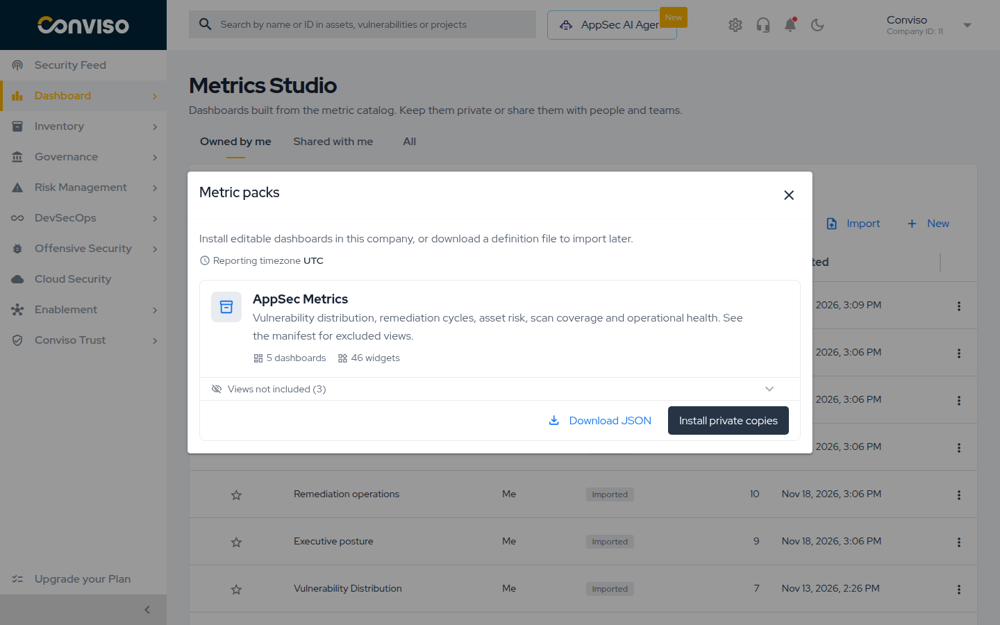

**Metrics Studio** lets you create security metrics to manage your application security program. Define what matters to your organization, measure it using Conviso Platform data, and use the results to prioritize work, follow remediation commitments, and demonstrate progress.

Start with the metric catalog or a ready-made metric pack. Choose the assets to measure, the relevant filters, the comparisons, and the reporting period. Save and share those definitions so security teams, engineering, and leadership can use consistent criteria in their reviews.

*Executive posture metrics help focus a review on priority vulnerabilities and the evolution of the backlog. Each indicator has its own measurement scope and time rules.*

## What you can achieve

Metrics Studio connects measurement with the decisions your team needs to make:

| Management question | Metrics to use |
| --- | --- |
| Where should we focus this week? | Open vulnerabilities by severity, overdue work, and the most common vulnerabilities. |
| Are we reducing the backlog? | Historical backlog alongside vulnerabilities recorded and remediation trends. |
| Are teams meeting remediation deadlines? | Current service-level agreement (SLA) states and the share of fixes completed within SLA. |
| Where are we missing testing evidence? | Scanner configuration, recent successful scans, and assets missing a successful scan. |
| How do we communicate progress? | A focused set of risk, remediation, and coverage indicators with saved reporting settings. |

Keep a collection private while preparing it, share the same saved collection with colleagues, or give another team an independent copy to adapt. Each person sees metrics calculated from the data they are allowed to access.

## How metrics are organized

- A **metric** answers a measurement question, such as how many priority vulnerabilities remain open or what share of fixes met their deadline. Select a metric from the catalog and configure its scope and comparisons.
- A **collection** saves related metrics together with reporting defaults. For example, a weekly remediation review can bring open work, deadline compliance, and remediation speed into the same management routine.
- A **widget** presents a metric as a number, table, or chart. Choose the format after deciding what to measure and which decision the result should support.

You do not need to write queries. The catalog explains what each metric counts, and supported results link to the records behind the number.

## Before you start

You need:

- Access to a company where **Metrics Studio** is available.
- A profile that allows you to manage your own Metrics Studio collections, or access to a collection someone has shared with you.
- Access to the underlying data you want to measure, such as assets, vulnerabilities, or scan results.

Creating metrics in your own collections, installing packs, and importing definitions require permission to manage your own collections. A person with read-only access can explore collections shared with them.

If the menu or an action is missing, ask your administrator to review your [profile and access](../../access-management/users-and-access.mdx).

## Open Metrics Studio

1. Select the company you want to work with.
2. In the left menu, expand **Dashboard**.
3. Select **Metrics Studio**.

The list shows the collections available to you. Use **Owned by me**, **Shared with me**, or **All** to change the list, and **Search by name** to find a collection.

*Step 3: The Metrics Studio list shows your saved collections and the actions to install a pack, import a definition, or create a collection.*

If you have a favorite, Metrics Studio opens it directly. Select **Metrics Studio** in the breadcrumb at the top of the page to return to the list.

## Quick start: use a metric pack

A **metric pack** supplies ready-made metrics organized for common management needs. Install a pack to start measuring risk, remediation, or coverage, then adapt the metrics and reporting scope to your team's responsibilities.

1. From the Metrics Studio list, select **Metric packs**.
2. Review the available pack's description, collection count, and **Views not included**.
3. Check the displayed **Reporting timezone**, which is taken from your browser. You can change each installed collection's timezone in its editor afterward.
4. Select **Install private copies**.
5. Open one of the new collections from the list.

The installed collections belong to you and start private. You can rename them, change their widgets, and share them when they are ready. Installing a pack creates copies; it does not update collections you installed earlier.

*Step 4: Install private copies creates editable collections from the pack. Download JSON saves the definitions for later import.*

:::tip Choose a starting point
For a first leadership review, start with **Executive posture** when it is included in the pack. For daily triage, try **Remediation operations**. Other pack collections focus on engineering work, coverage and source health, or movement and ownership. Review the pack contents before installing.
:::

Prefer to choose each metric yourself? Follow [Create metrics](./create-metrics.md).

## Use the metrics in your management routine

1. Check the **Period** and reporting timezone.
2. Use **Assets** and **Asset tags** in the filter bar above the widgets to select your reporting scope.
3. Read the widget titles and open **About this data** to understand what each metric measures.
4. Select **Refresh** when you want to calculate the metrics again.
5. If you can edit the collection and want to reuse these reporting settings, select **Save defaults**.

Changes to the period and filters are temporary until you save them as defaults. Saving defaults changes the shared starting settings, so choose settings that make sense for the people who use the collection.

See [Explore and understand your metrics](./explore-metrics.md) for date rules, filtering, and the records behind a number.

During a review, use priority and deadline metrics to decide what needs attention. Compare historical metrics to assess progress, then inspect the supporting records to understand which work contributes to the result. Use that evidence to agree on the next actions and who will follow them up.

## Confirm you are ready

You have a working starting point when you can reopen your saved collection, recognize the questions its widgets answer, and explain the selected scope and period. Check that at least one widget shows a result consistent with the data you can access.

An empty result can be valid. For example, a remediation metric may have no samples when no fixes were completed during the selected period. Use the checks below before changing the metric.

## Troubleshooting

| What you see | What to do |
| --- | --- |
| Metrics Studio is missing from the menu. | Confirm the selected company, feature availability, and your profile's Metrics Studio permissions with your administrator. |
| **New**, **Import**, or **Metric packs** is missing. | Ask your administrator whether your profile permits managing your own collections. Shared viewing access alone does not enable creation. |
| No collections appear. | Check the ownership tab and clear the name or origin filter. If you only have read-only access, ask the owner to share a collection with you. |
| Widgets show no results. | Check the filters, the metric's date rules, and whether the underlying data exists in your scope. See [Widget messages](./explore-metrics.md#widget-messages). |
| A pack cannot be installed. | Check the displayed error and your collection limit. Try again after resolving the reported issue. |

## Next steps

- [Create metrics](./create-metrics.md): define a management question, configure its measurement, and verify the result.
- [Explore and understand your metrics](./explore-metrics.md): filter results and investigate the records behind them.
- [Share and reuse metrics](./share-and-reuse.md): give teams consistent metric definitions or independent copies to adapt.
