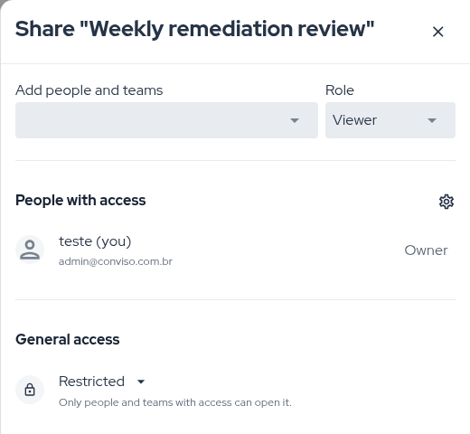

Give security, engineering, and leadership consistent measurement criteria by sharing a collection of Metrics Studio metrics. Teams can work from the same saved definitions while each person's access controls the data they can see. When another team needs to adapt the metrics to its own responsibilities, send it an independent copy.

## Before you start

Save the collection before sharing it. The actions available to you depend on your role in the collection, your Metrics Studio permissions, and the owner's sharing settings.

Sharing a collection does not grant access to its underlying company data. Each person's numbers reflect the assets and records that person can access, so two people can open the same collection and see different results.

## Choose how to collaborate

| Your goal | Action | What happens afterward |
| --- | --- | --- |
| Review and maintain the same saved collection together. | **Share** | Everyone with access opens the same saved definition. Saved edits appear when they open or reload it. |
| Give another team its own starting point. | **Send a copy** | Each recipient owns an independent copy. Later changes to the original do not reach it. |
| Experiment without changing the original. | **Duplicate** or **Make a copy** | You own a separate copy to edit. |
| Move a reporting setup through a file. | **Export definition**, then **Import** | A definition file recreates the setup; it is not a download of the calculated results. |

## Share a saved collection

1. Open the saved collection and select **Share**. You can also use **Share** in its row's actions menu on the list.
2. In **Add people and teams**, search for a colleague or team in the company.
3. Choose **Viewer** or **Editor**.
4. Review the proposed access changes.
5. Select **Share** or **Save changes**, as shown in the panel.
6. Select **Copy link** to get the link for the people you have given access to.

Access changes take effect when you save them. Closing a panel with unsaved changes does not give or remove access.

*Step 3: Choose who can open the saved collection and whether they can view or edit it. General access remains Restricted until you change it.*

### Choose the right role

| Role | Intended use |
| --- | --- |
| **Viewer** | Open the collection, inspect metrics, and explore temporary periods and filters. Copying and exporting depend on the owner's settings and the person's own permissions. |
| **Editor** | Maintain the widgets, layout, and saved reporting defaults. Sharing access depends on the owner's settings. |
| **Owner** | Control the collection, its sharing settings, ownership transfer, and deletion. |

An Editor grant cannot override the person's profile. If the panel shows **Can only view**, ask an administrator to review that person's Metrics Studio permissions before expecting them to edit.

### Keep access restricted or enable company access

Under **General access**, choose:

- **Restricted** to allow only people and teams with access.
- **Everyone at [company]** to allow people in the company who have a Metrics Studio role to open the collection with its link. Choose their Viewer or Editor role and confirm the change.

Company access still requires a platform account and the appropriate company permissions. Copying a link alone does not grant access to a restricted collection.

### Control copying and further sharing

The owner can open **Sharing settings** to manage:

- **Editors can change permissions and share**.
- **Viewers can make a copy and export**.

To remove a direct grant, select **Remove access** for the person or team and save. A person may still have access through another team or company access.

## Send independent copies

1. Select **Metrics Studio** in the breadcrumb to return to the list.
2. Open the collection's actions menu and select **Send a copy**.
3. Select recipients from the company.
4. Select **Send a copy** to confirm.

Each recipient receives a separate copy of the saved configuration. Their metrics use their own data access. Later edits to the original are not synchronized.

Delivered copies belong to their recipients. You cannot revoke or edit those copies through the original collection's sharing settings.

To make a copy for yourself, use **Duplicate** in the list or **Make a copy** from an open collection when that action is available. Rename the copy so its purpose is clear.

## Export and import a definition

A **definition** is a JSON file containing a collection's configuration, such as its widgets, filters, layout, and reporting settings. Use it to reuse a setup without rebuilding it by hand. You do not need to edit the file.

### Export

1. In the list, open the collection's actions menu.
2. Select **Export definition**.
3. Keep the downloaded JSON file for later import.

Metric packs also offer **Download JSON** if you want to save a pack's definitions before installing them.

### Import

1. Open Metrics Studio in the destination company.
2. Select **Import**.
3. Choose the JSON definition file.
4. Review the validation results and the collections that will be created.
5. Check any **Unavailable references** before continuing.
6. Select **Import** to create the collections.

Checking a file does not create collections; the final confirmation does. Imported collections are independent copies, evaluated using the destination company and your access there.

Saved assets or other references from the original context may be unavailable in the destination. Unavailable selections remain applied and can narrow results to nothing. Review imported filters before relying on their metrics.

## Transfer ownership or leave a shared collection

An owner can use **Transfer ownership** from the sharing controls to hand responsibility to an eligible person. The new owner must be active, have company access, and be allowed to manage Metrics Studio collections. The former owner becomes an editor when their account is active.

Use **Leave** on a shared collection when that action is available to remove your direct access. If access comes through a team or company access, ask the owner or administrator to review that source instead.

Only the owner can delete the shared collection. Deletion removes access to that original for everyone; previously delivered independent copies remain separate.

## Confirm it worked

For shared access, reopen **Share** and confirm the expected people, teams, and roles are listed. Ask the recipient to open the saved collection and verify that it is available with the intended role.

For a copy or import, open the new collection and check its name, widgets, reporting settings, and filters. Confirm that it uses the expected data scope before using it for a review.

## Troubleshooting

| What happens | What to do |
| --- | --- |
| A colleague cannot open the link. | Check the selected company, saved sharing grants, team membership, and the colleague's Metrics Studio access. |
| People see different numbers. | Compare their data access, viewing filters, widget settings, and evaluation times. Shared access to a collection does not equal shared access to all data. |
| **Share** or sharing changes are unavailable. | Ask the owner to review your role and whether editors are allowed to share. |
| A recipient marked Editor can only view. | Ask an administrator to review their profile's permission to manage Metrics Studio collections. |
| Copying or exporting is unavailable. | Check your creation permissions and the owner's **Viewers can make a copy and export** setting. |
| An import fails. | Read the validation errors, confirm the file is a supported definition, and check the displayed file-size and collection limits. |
| Removing a person's direct access has no effect. | Check whether a team grant or company access still allows them to open the collection. |
