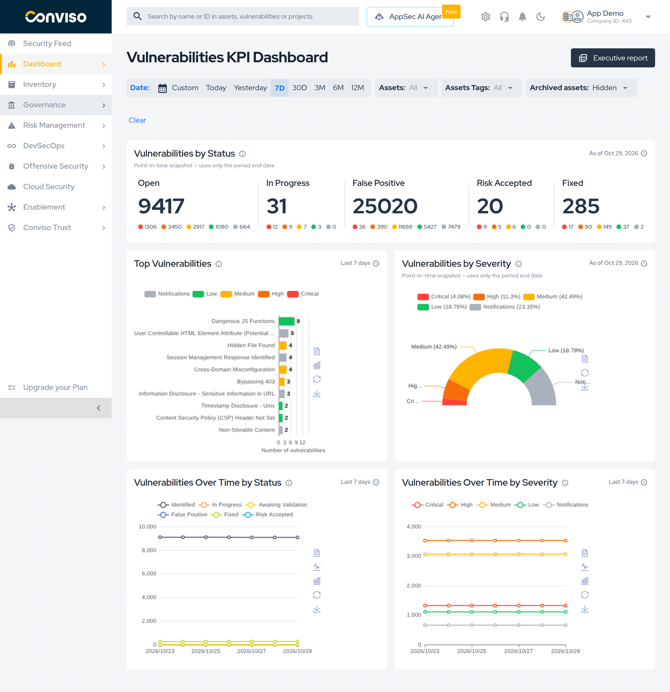

## Overview

The **Vulnerability KPI** dashboard highlights the main indicators for vulnerability volume, severity distribution, and evolution over time.

It helps teams answer questions such as:

* how many vulnerabilities are in each status on a given date;
* how vulnerabilities are distributed by severity on a given date;
* which vulnerabilities were created most often in a period;
* whether the backlog is growing or stabilizing over time.

## How the selected period is used

Not every chart reads the selected period the same way:

* **Snapshot charts** (**Vulnerabilities by Status** and **Vulnerabilities by Severity**) use **only the end date** of the period. They show each vulnerability in the status it held on that date. These charts show the caption **Point-in-time snapshot** and an **As of** date in the top right corner.
* **Period charts** (**Top Vulnerabilities** and both **Over Time** charts) use the **whole period**, from the start date to the end date. They show the period in the top right corner, for example **Last 7 days**.

The presets **Today**, **7D**, **30D**, **3M**, **6M**, and **12M** all end today. For the snapshot charts, they all show the current state, so they return the same numbers; only the period charts change between them. To see the snapshot of another date, use **Yesterday** or a **Custom** range that ends on that date.

## Charts

### Vulnerabilities by Status

Five cards, each counting the vulnerabilities whose status on the end date falls in its group:

* **Open**: `Identified`, `In Progress`, and `Awaiting Validation`;
* **In Progress**: `In Progress` (these are also counted in **Open**);
* **False Positive**: `False Positive`;
* **Risk Accepted**: `Risk Accepted`;
* **Fixed**: `Fixed`.

**Fixed** is the number of vulnerabilities in the `Fixed` status on the end date, not the number fixed during the period. Each card also breaks its total down by severity.

### Top Vulnerabilities

The 10 most frequent vulnerabilities **created within the selected period** (by creation date), grouped by title and broken down by severity. The current status is not considered.

### Vulnerabilities by Severity

The distribution by severity of the vulnerabilities that existed on the end date, in any status, including `False Positive`, `Fixed`, and `Suppressed`.

### Vulnerabilities Over Time by Status and by Severity

How the number of vulnerabilities changes over the selected period, one point per day, or one point per week when the period is longer than 60 days. These charts count the `Identified`, `In Progress`, `Awaiting Validation`, `Fixed`, and `Risk Accepted` statuses; `False Positive` and `Suppressed` are not included.

For status meanings and lifecycle rules, see [Workflow Status](../vulnerability-management/workflow-status.md).

## Filters

The dashboard uses the filters described in [Dashboard filters](../platform/dashboard.md#filters): date range, assets, asset tags, and archived assets.

To choose a **Custom** range, click **Custom**, then click the start date and then the end date in the calendar. The dashboard updates after the second click.

## Example

