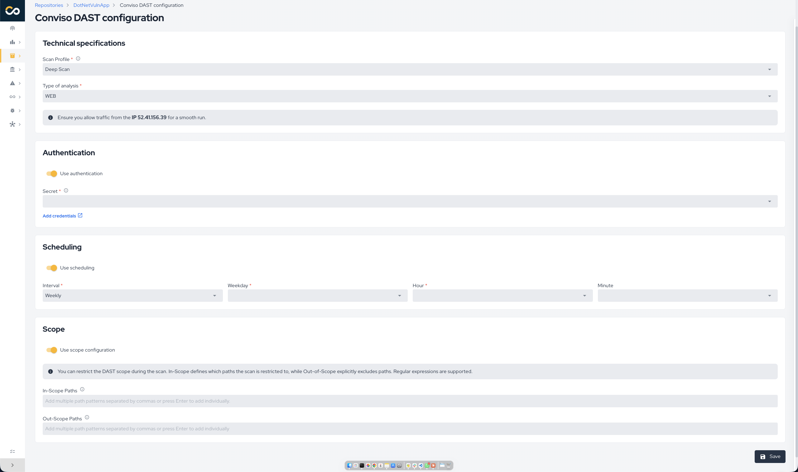
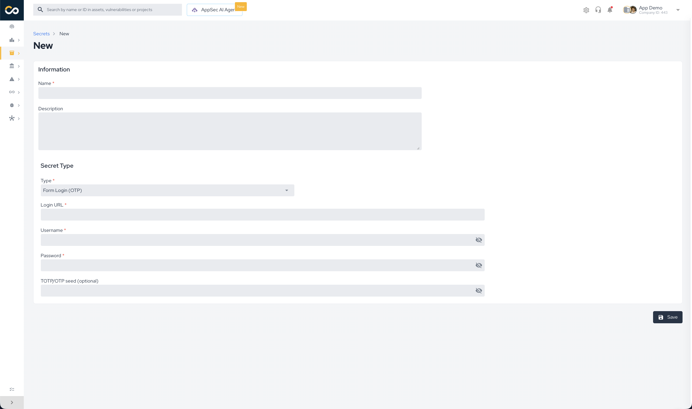

import Tabs from '@theme/Tabs';
import TabItem from '@theme/TabItem';

## Introduction

Scan and protect your application with Conviso DAST, consolidating all your vulnerabilities and risks in the Conviso Platform.

Conviso DAST (Dynamic Application Security Testing) analyzes your application **while it is running**, exactly as an attacker would see it — with no access to the source code. It automatically maps the application's attack surface, sends real attacks against it, and reports the confirmed vulnerabilities directly into the Conviso Platform, each with the evidence needed to reproduce and fix it.


## Capabilities

Conviso DAST combines several techniques into a single automated scan.

### Attack surface discovery

Before testing, the DAST maps everything it can reach:

- **Automated crawling** of links and forms across the application.
- **JavaScript-aware crawling** with a real browser engine — it fully renders and interacts with modern **single-page applications (SPAs)** (React, Angular, Vue, and similar), following client-side navigation and submitting forms so that dynamically loaded pages are reached.
- **Endpoint recovery from client-side code** — extracts API routes referenced inside the application's JavaScript, recovering endpoints that never appear as static links.
- **Automatic API discovery** — when no API definition is supplied, the DAST automatically probes for and imports common API specifications (**OpenAPI/Swagger** and **GraphQL**) exposed by the application, so the API surface is tested with **no manual configuration**.
- **Historical reconnaissance** — discovers previously known URLs of the target from public sources.
- **Hidden parameter discovery** — detects undocumented parameters that expand the testable surface (a common blind spot on modern APIs).

### Vulnerability testing

- **Passive analysis** — inspects every response for security misconfigurations, insecure or missing security headers, insecure cookies, information disclosure, and session-handling issues, without sending any attack. Safe to run against production.
- **Active analysis** — sends crafted payloads to detect issues such as SQL/NoSQL injection, OS command injection, server-side template injection, cross-site scripting (reflected and DOM-based), path traversal, insecure HTTP methods, and more.
- **Out-of-band (OOB) detection** — catches **blind** vulnerabilities that produce no visible response, such as blind SSRF and blind injection, by observing out-of-band interactions triggered by the payloads.
- Broad, continuously updated rule coverage, mapped to **CWE** and the **OWASP Top 10**.

### AI / LLM endpoint testing

When the target exposes an **AI / LLM endpoint** (chat or completion style), the DAST additionally tests it against the **OWASP LLM Top 10** — including prompt injection, jailbreak, and sensitive-information disclosure.

### API testing

Point the DAST at an API definition (**OpenAPI/Swagger**, **GraphQL**, or **SOAP**) and it imports every operation — including request bodies — so the full API surface is exercised, not just what a crawler can reach.

**You don't have to provide the definition, though.** When none is configured, the DAST performs **automatic API discovery** — it probes the application for common specification locations (OpenAPI/Swagger and GraphQL) and, if it finds one, imports and tests it automatically.

### Authenticated testing

Most real risk lives behind the login. Conviso DAST can scan **authenticated areas** using either static credentials or an interactive browser login, including multi-step and single sign-on (SSO) flows and **multi-factor authentication (OTP/TOTP)**. See [Authentication](#authentication).


### Evidence and consolidation

Every finding ships with the **real HTTP request and response** that proves it, plus severity, CWE, description, remediation guidance, and references. Results are automatically **deduplicated** and consolidated in the Conviso Platform, and a vulnerability that is no longer present is **automatically closed** once two consecutive scans stop reporting it.


## Quick Start

The scan is configured on the asset's **CI/CD** tab (see [Running a scan](#running-a-scan)). The settings below are available.



### Scan profiles

The **Scan Profile** controls how deep and how aggressive the analysis is. Choose it based on where the target runs and how much load it can take.

| Profile | What it does | Intrusiveness | Recommended for |
| --- | --- | --- | --- |
| **Basic** | Passive-only checks. Maps the application and inspects responses; sends no attacks. | Non-intrusive — **safe for production**. Fastest. | Quick, low-risk checks and production targets. |
| **Balanced** *(recommended)* | Passive analysis **plus** active testing at **medium** attack strength, with JavaScript-aware crawling. | WAF-safe; moderate load and duration. | The default choice for most applications. |
| **Deep Scan** | The most **comprehensive** and aggressive analysis: intensive JavaScript crawling with form interaction, active testing at **high** strength with a lower alerting threshold (maximum coverage), optional out-of-band detection, and longer time budgets. | Most intrusive and longest-running. | Staging / pre-production, when maximum coverage matters. |

:::tip
Start with **Balanced** for a new target. Move to **Deep Scan** in a non-production environment when you want the widest possible coverage.
:::


### Analysis types

When configuring the scan, choose the **Type of analysis**:

- **Web** — for web applications and SPAs. The DAST crawls and actively tests the rendered application.
- **API** — for APIs. Provide the **API format** (**OpenAPI**, **GraphQL**, or **SOAP**) and the location of the API definition. The DAST imports the definition and tests each operation, including request bodies.

### Authentication

If your application requires login to reach protected areas, configure authentication so the DAST scans **as an authenticated user**. Without it, only the public surface is tested.

Two families of authentication are supported:

**1. Static credentials** — a fixed secret is attached to **every request** the DAST sends. Best for token / API-key based applications. Available methods:

| Method | You provide |
| --- | --- |
| **Basic Auth** | Username and password |
| **Bearer Token** | A token value (sent as `Authorization: Bearer …`) |
| **Custom Header** | A header name and value |
| **Cookie** | A cookie name and value |
| **Query Parameter** | A parameter name and value appended to requests |

**2. Interactive (form) login** — the DAST drives a **real browser** through your login screen, so it works with dynamic SPA logins, multi-step screens, and SSO. You provide:

- The **login page URL**
- The **username** and **password**
- *(optional)* A **multi-factor (OTP/TOTP) secret** — when your login requires a one-time code, provide the TOTP seed and the DAST generates valid codes automatically during login.



### Custom HTTP headers *(optional)*

Use the **Custom HTTP Headers** card to add non-authentication headers to every request made during the DAST scan. This is useful when the target expects metadata such as a tenant identifier, locale, correlation ID, or a header required to route traffic through a specific environment.

Enter each header as a name and value separated by a colon:

```text
X-Custom-Header: Header value
```

For example:

```text
X-Tenant-ID: tenant-123
Accept-Language: en-US
```

Add each header as a separate entry. The value can contain additional colons, such as in `X-Callback: https://example.com:8443`.


#### Common use cases

Custom HTTP headers are a standard capability in DAST tools and can help adapt the scan to the target environment. Common use cases include:

- **Identify scanner traffic** — add a header such as `X-DAST-Scan: conviso` or customize the `User-Agent` so requests can be identified in application logs, SIEM platforms, and APM tools. This also helps security teams distinguish authorized DAST activity from real attacks.
- **Work with security controls** — use an agreed header such as `X-Allow-Scanner: true` to apply a controlled rule for CAPTCHA, WAF, or bot-protection systems. This can improve scan coverage and reduce false negatives caused by blocked scanner requests.
- **Route requests through infrastructure** — provide metadata required by API gateways, reverse proxies, service meshes, or other routing components.
- **Select a tenant or environment** — identify the correct context in multi-tenant systems or target a dedicated staging or homologation environment, for example with `X-Tenant-ID: tenant-123` or `X-Environment: staging`.
- **Reach test-only application paths** — use a header agreed with the application team, such as `X-Internal-Access: conviso-dast`, when the test environment exposes additional routes to authorized scanners.

These options give teams more control over how the scanner interacts with their infrastructure, helping it reach the intended attack surface without requiring application changes for each scan.

:::note
Use the **Authentication** card for credentials. Authentication headers, headers whose names indicate sensitive credentials (such as tokens, secrets, or passwords), and HTTP headers managed by the scanner cannot be added in **Custom HTTP Headers**. The Platform displays a validation message when a header is not allowed.
:::

### Scope Definition *(optional)*

Restrict what the DAST is allowed to reach using **In scope** and **Out of scope** URL patterns. Scope entries are **regular expressions matched against the complete URL**, not simple text or wildcard rules:

- **In scope** — only URLs matching these patterns are scanned.
- **Out of scope** — URLs matching these patterns are never scanned (for example, logout, destructive actions, or third-party areas).

If the same URL matches both lists, **Out of scope takes precedence** and the URL is not scanned. You can add multiple entries to either list; a URL only needs to match one applicable entry.

#### Choose the correct pattern format

Use one of the following formats. The leading slash or URL scheme is significant.

| What you want to match | Pattern format | Example |
| --- | --- | --- |
| A path on the asset, with either HTTP or HTTPS | Start with `/` | `/admin/.*` |
| A path on one specific origin | Include `http://` or `https://` | `https://app.example.com/admin/.*` |
| The complete application on a hostname | Enter only the hostname | `app.example.com` |

For an asset configured as `https://www.example.com`, these are common configurations:

| Goal | List | Pattern |
| --- | --- | --- |
| Scan only the API | In scope | `/api/.*` |
| Scan only version 1 of the API | In scope | `/api/v1/.*` |
| Exclude logout, including URLs with query strings | Out of scope | `/logout.*` |
| Exclude every Cloudflare internal route | Out of scope | `/cdn-cgi/.*` |
| Exclude a destructive endpoint and everything below it | Out of scope | `/account/delete/.*` |
| Exclude a specific URL on a specific origin | Out of scope | `https://www.example.com/private/.*` |
| Include an entire application hostname | In scope | `api.example.com` |

Relative patterns are resolved against the asset hostname and work with both HTTP and HTTPS. For example, `/cdn-cgi/.*` excludes both:

```text
http://www.example.com/cdn-cgi/trace
https://www.example.com/cdn-cgi/challenge-platform/...
```

Absolute patterns include the scheme and are useful when the protocol or origin matters:

```text
https://www.example.com/internal/.*
```

:::caution Do not combine a hostname and path without a URL scheme
`www.example.com/cdn-cgi/.*` is **not** an absolute URL pattern. Because it has no `http://` or `https://`, it is interpreted as a path relative to the asset and will not exclude `https://www.example.com/cdn-cgi/...`.

Use either the relative path:

```text
/cdn-cgi/.*
```

or the complete URL pattern:

```text
https://www.example.com/cdn-cgi/.*
```

Adding `.*` before the hostname does not fix the format. For example, `.*www.example.com/cdn-cgi/.*` is still interpreted as a relative pattern because it has no URL scheme.
:::

#### Regular expression behavior

- `.*` means “zero or more of any character”. Use it after a path prefix when all URLs below that prefix should match.
- `/admin` matches that exact path. Use `/admin/.*` when child URLs such as `/admin/users` must also match.
- Patterns are evaluated against the **entire URL**. A fragment such as `cdn-cgi` by itself does not mean “contains this text anywhere.”
- Query strings are part of the URL. Therefore, `/logout` does not match `/logout?next=/home`; use `/logout.*` when the path and all of its query-string variants must be excluded. A broad suffix such as `.*` also covers URLs like `/api/users?page=2`.
- When writing an absolute regular expression, escaping dots in the hostname is the strict regex form: `https://www\.example\.com/api/.*`. The simpler `https://www.example.com/api/.*` form is accepted, but unescaped dots are regex wildcards and can match unintended characters.
- A relative pattern inherits an explicit port from the asset URL. For example, if the asset is `https://app.example.com:8443`, `/api/.*` only applies on port `8443`.
- Invalid regular expressions and unsupported URL schemes are ignored. Check the execution logs after changing scope to identify rejected entries.

:::caution In scope does not authorize unrelated domains
For security and authorization reasons, an **In scope** entry can only reference the asset domain or one of its subdomains. Domains belonging to another company or unrelated third parties are ignored, even when explicitly added. To scan another domain, register and configure it as a separate authorized asset.
:::

:::tip Recommended approach
Prefer **relative path patterns** for routes on the configured asset, such as `/api/.*` or `/logout.*`. Use an **absolute URL pattern** only when you intentionally need to distinguish a scheme, hostname, subdomain, or port. After changing the scope, check the execution logs for ignored patterns, run a new scan, and review **Scanned URLs** to confirm that the intended surface was included and sensitive routes were excluded.
:::

When no **In scope** pattern is configured, the DAST scans the authorized application surface it discovers. Adding a valid, supported **In scope** entry narrows that surface to matching URLs. The DAST can also automatically recognize authorized cloud backends related to the asset when no explicit include list replaces the default scope; third-party and managed-service URLs remain outside the authorized target.


### Scheduling *(optional)*

Define when the DAST runs automatically — **monthly** or **weekly** — choosing the day and the execution time (in **GMT-3**). You can also run a scan on demand at any time with **Run Now**.


### Understanding the results

1. The scan details page displays comprehensive information about the execution:

<div style={{textAlign: 'center' , maxWidth: '100%'}}>


</div>

- **Target URL**: The URL that was scanned
- **Scanned URLs**: Which URLs were analyzed during the scan
- **Total Vulnerabilities**: The total number of vulnerabilities found
- **New Vulnerabilities**: The number of newly discovered vulnerabilities
- **Fixed Vulnerabilities**: The number of vulnerabilities that were resolved since the last scan
- **Execution Time**: The date and time when the scan was executed
- **Duration**: How long the scan took to complete
- **Execution Logs**: Detailed logs of the scan execution process

You can also generate a detailed report of the scan execution from this page clicking on **Generate report** button.


:::note
When the vulnerability is fixed, the scans that follow stop reporting it. After two consecutive scans without it, the Platform changes the vulnerability status to "Fixed" automatically — the second scan is what confirms the fix, so a single scan that misses the vulnerability never closes it on its own.
:::

With the above, you should be able to run DAST on the Conviso Platform.

## Self-Hosted DAST

Conviso DAST can also run **self-hosted** — inside your own pipeline or infrastructure — using the published Docker image, while still reporting results into the Conviso Platform exactly like a platform-managed scan.

### Prerequisites

- Docker (or any container runtime able to run a Docker image)
- A Conviso Platform **API key** with access to the target asset
- The asset's **ID**, visible on the asset page in the Conviso Platform
- Network access from wherever the container runs to both the **target application** and the **Conviso Platform**

### Running a scan

:::caution Always pull before scanning
`docker run` does **not** refresh the `:latest` tag on its own — if the image already exists on your machine, Docker reuses that local copy as-is, even though `:latest` is rebuilt regularly. Running an old cached image can produce confusing failures (unrelated arguments, missing features) that look like a scanner bug but are actually just a stale image. Always run `docker pull` immediately before scanning, as shown below — or pin to a specific tag instead of `:latest` (see the tip further down).
:::

<Tabs groupId="os">
<TabItem value="bash" label="Bash / Linux / macOS" default>

```bash
docker pull convisoappsec/convisodast:latest

docker run --rm \
  -e CONVISO_API_KEY="your-api-key" \
  -e ASSET_ID="12345" \
  -e TARGET_URL="https://example.com" \
  -e CONVISO_API_URL="https://api.app.convisoappsec.com/graphql" \
  -v "$(pwd)/results:/scan/results" \
  convisoappsec/convisodast:latest
```

</TabItem>
<TabItem value="powershell" label="Windows (PowerShell)">

```powershell
docker pull convisoappsec/convisodast:latest

docker run --rm `
  -e "CONVISO_API_KEY=your-api-key" `
  -e "ASSET_ID=12345" `
  -e "TARGET_URL=https://example.com" `
  -e "CONVISO_API_URL=https://api.app.convisoappsec.com/graphql" `
  -v "${PWD}/results:/scan/results" `
  convisoappsec/convisodast:latest
```

</TabItem>
<TabItem value="cmd" label="Windows (Command Prompt)">

```bat
docker pull convisoappsec/convisodast:latest

docker run --rm ^
  -e "CONVISO_API_KEY=your-api-key" ^
  -e "ASSET_ID=12345" ^
  -e "TARGET_URL=https://example.com" ^
  -e "CONVISO_API_URL=https://api.app.convisoappsec.com/graphql" ^
  -v "%cd%/results:/scan/results" ^
  convisoappsec/convisodast:latest
```

</TabItem>
</Tabs>

:::note
PowerShell uses `` ` `` (backtick) and Command Prompt uses `^` for line continuation instead of Bash's `\` — pasting the Bash version as-is into either will not work. Make sure the continuation character is the very last character on the line; a trailing space after it silently breaks the continuation and splits the command.
:::

Findings are reported back to the Conviso Platform the same way a platform-managed scan does, and appear on the asset's vulnerability list once the scan finishes. Mounting `/scan/results` is optional — it's only needed if you also want the raw scan output on your own filesystem.

:::tip
Pin to a specific version (`convisoappsec/convisodast:<tag>`) instead of `:latest` if you need a reproducible scan across runs. Available tags are listed on the [Conviso DAST page at Dockerhub](https://hub.docker.com/r/convisoappsec/convisodast).
:::

#### Required environment variables

| Variable | Description |
| --- | --- |
| `CONVISO_API_KEY` | Your Conviso Platform API key. |
| `ASSET_ID` | The ID of the asset being scanned. |
| `TARGET_URL` | The URL to scan. |
| `CONVISO_API_URL` | The Conviso Platform GraphQL endpoint. Defaults to `https://api.app.convisoappsec.com/graphql` if not set. |

### Dry run

Want to try Conviso DAST out before pointing it at a real asset? Set `DRY_RUN="true"` to run a full scan against your target — attack surface discovery, vulnerability testing, everything — without registering anything on the Conviso Platform:

<Tabs groupId="os">
<TabItem value="bash" label="Bash / Linux / macOS" default>

```bash
docker pull convisoappsec/convisodast:latest

docker run --rm \
  -e DRY_RUN="true" \
  -e CONVISO_API_KEY="your-api-key" \
  -e TARGET_URL="https://example.com" \
  -v "$(pwd)/results:/scan/results" \
  convisoappsec/convisodast:latest
```

</TabItem>
<TabItem value="powershell" label="Windows (PowerShell)">

```powershell
docker pull convisoappsec/convisodast:latest

docker run --rm `
  -e "DRY_RUN=true" `
  -e "CONVISO_API_KEY=your-api-key" `
  -e "TARGET_URL=https://example.com" `
  -v "${PWD}/results:/scan/results" `
  convisoappsec/convisodast:latest
```

</TabItem>
<TabItem value="cmd" label="Windows (Command Prompt)">

```bat
docker pull convisoappsec/convisodast:latest

docker run --rm ^
  -e "DRY_RUN=true" ^
  -e "CONVISO_API_KEY=your-api-key" ^
  -e "TARGET_URL=https://example.com" ^
  -v "%cd%/results:/scan/results" ^
  convisoappsec/convisodast:latest
```

</TabItem>
</Tabs>

`CONVISO_API_KEY` is still required for a dry run: it's used once, to confirm the key belongs to an active company on the Conviso Platform, so the feature can't be used to scan targets anonymously. Beyond that single check, the platform is never contacted — no scan-policy check, no analytics, no vulnerabilities are registered, and no `ASSET_ID` is needed. Scan output is still written to `/scan/results` as usual, so you can review findings locally.

:::note
A dry run does **not** pick up your asset's platform-configured Scan Profile, Scope, or Authentication (see [Using your existing scan configuration](#using-your-existing-scan-configuration) below) — that lookup needs `ASSET_ID` and is skipped too, on purpose. A dry run always uses local defaults unless you pass those settings yourself as environment variables.
:::

:::tip
Use a dry run to validate connectivity and confirm the scan pipeline itself works against your target before wiring it up to a real asset.
:::

### Using your existing scan configuration

You don't need to re-enter settings you've already configured on the asset's **CI/CD** tab (see [Quick Start](#quick-start)). For any of the settings below that you don't pass explicitly as an environment variable, the self-hosted scan automatically uses whatever is already configured for that asset on the Conviso Platform — the same **Scan Profile**, **Scope Definition**, **Authentication**, and **API testing** definition used by platform-managed scans.

| Variable | Matches this platform setting |
| --- | --- |
| `SCAN_PROFILE` | [Scan profile](#scan-profiles) (`Basic`, `Balanced`, `Deep Scan`) |
| `DAST_SCOPE_CONFIGURATION` | [Scope Definition](#scope-definition-optional) (in scope / out of scope) |
| `AUTH_CONFIG` | [Authentication](#authentication) |
| `API_FORMAT`, `API_SCHEMA_URL`, `API_SCHEMA_FILE` | [API testing](#api-testing) definition |
| `COMPANY_ID` | Automatically resolved from `ASSET_ID` if not provided |

Any variable you pass explicitly is always respected as-is and takes precedence over what's configured on the platform. If a setting isn't passed **and** the platform has no configuration for that asset either, the scan falls back to safe defaults (Balanced profile, no scope restriction, no authentication).

:::note
Setting `AUTH_CONFIG` or `DAST_SCOPE_CONFIGURATION` by hand requires encoding them yourself (base64-encoded YAML and JSON, respectively). In most cases it's simpler to configure authentication and scope once on the asset's CI/CD tab and let the self-hosted scan pick them up automatically.
:::


## Support

Should you have any questions or require assistance while using the Conviso Application Security Testing, feel free to contact our dedicated support team.
