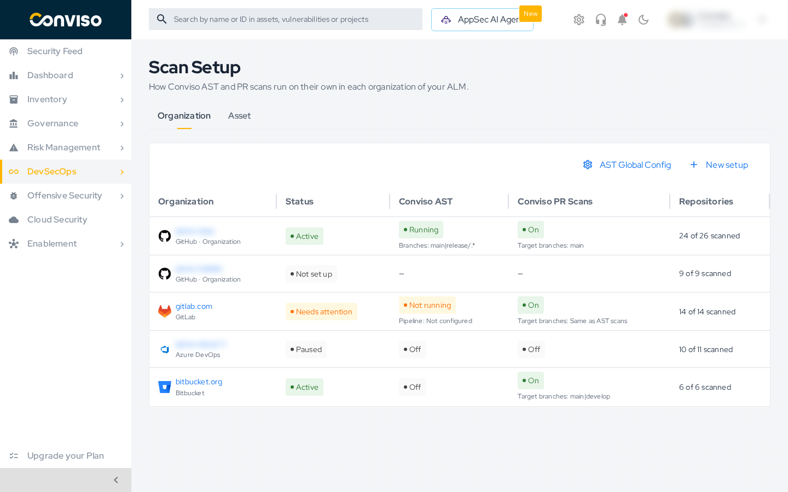
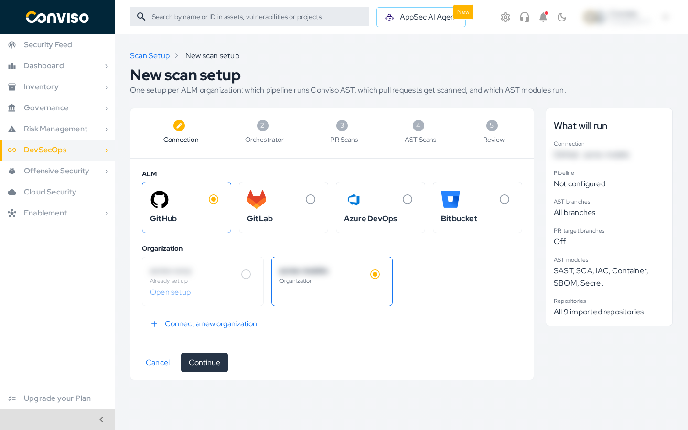
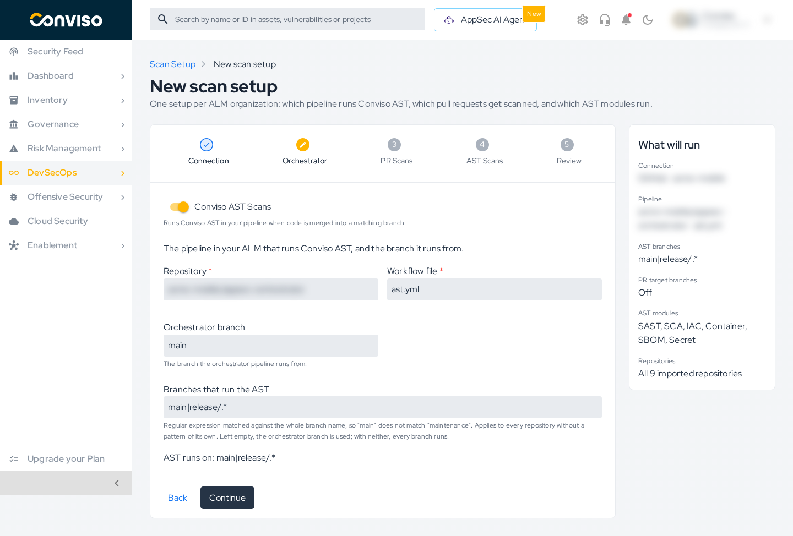
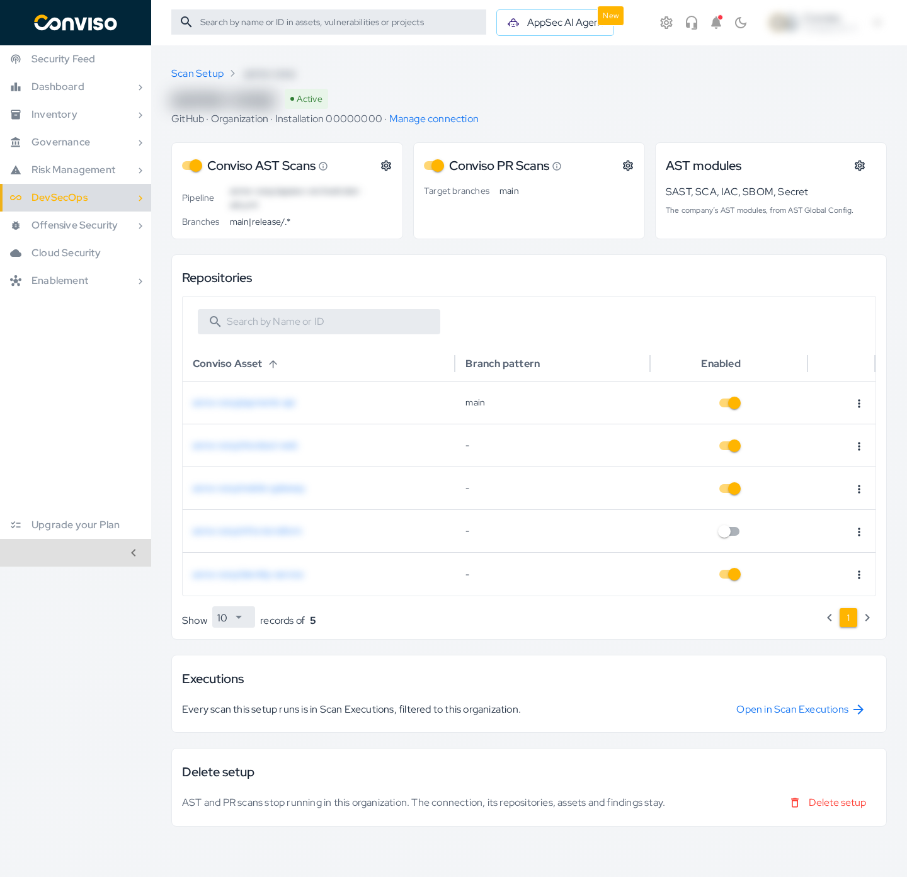
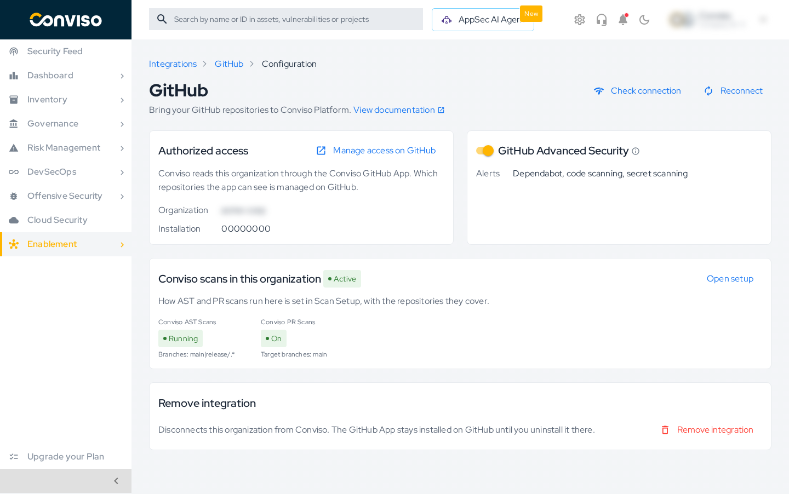

# Scan Setup

**Scan Setup** is where you decide how Conviso scans run on their own in your ALM:

- **Conviso AST Scans**: which pipeline runs Conviso AST when code is merged, and on which branches.
- **Conviso PR Scans**: which pull requests get a security check.
- **AST modules**: which AST modules run.

There is one setup per ALM connection: a GitHub organization or user account, or your company's GitLab, Azure DevOps, or Bitbucket integration. Connecting the ALM itself, and choosing which repositories Conviso can read, stays in [Integrations](../integrations/integrations_intro.md). You can also connect a new organization without leaving Scan Setup.

:::info Moved from the integration pages
The **AST Scans** and **PR Scans** settings, the orchestrator fields, and the repository table used to be on each ALM's integration page. They are now in Scan Setup. The integration page shows a [summary card](#from-the-integration-page) that opens the setup.
:::

## Open Scan Setup

In the side menu, open **DevSecOps → Scan Setup**. The page has two tabs:

| Tab | What it holds |
| :--- | :--- |
| **Organization** | One row per ALM connection, with how its scans run. |
| **Asset** | The scan configuration of each asset. See [Scan Configs](./scan-configs/scan-configs.md). |

| Column | What it shows |
| :--- | :--- |
| **Organization** | The organization or account, with its ALM and account type. An Azure DevOps connection with several organizations shows the first one and how many more; hover over the name to see them all. |
| **Status** | How the setup stands. See [Statuses](#statuses). |
| **Conviso AST** | **Running**, **Not running**, or **Off**, with the branches that run the AST. **Not running** means AST scans are on but the orchestrator pipeline is incomplete. |
| **Conviso PR Scans** | **On** or **Off**, with the target branches of the pull requests that get scanned. |
| **Repositories** | How many of the connection's imported repositories have scans enabled. |

Click a row to open its setup. A connection that is not set up yet opens the [wizard](#create-a-setup) with that connection already chosen.

The toolbar also has:

- **AST Global Config**: the company-wide AST modules every organization runs by default. See [AST Defaults](./scan-configs/ast-defaults.md).
- **New setup**: opens the wizard.

### Statuses

| Status | Meaning |
| :--- | :--- |
| **Active** | The scans that are on are ready to run: AST scans on merges to the AST branches, PR scans on pull requests to the target branches, or both. A setup with only PR scans on is also **Active**, and its merges do not start AST scans. |
| **Needs attention** | AST scans are on, but the orchestrator pipeline is incomplete, so merges do not start AST scans yet. Fill in the orchestrator fields. |
| **Paused** | The setup keeps its settings, but both AST and PR scans are off. |
| **Not set up** | Nothing is configured for this connection yet. |

## Create a setup

Click **New setup**. The wizard has five steps: **Connection**, **Orchestrator**, **PR Scans**, **AST Scans**, and **Review**. The **What will run** panel on the right follows your choices as you go.

### Step 1 – Connection

Choose the **ALM**, then the **Organization**. An organization that already has a setup shows **Already set up**, with a link to open it.

To use an organization that is not connected yet, click **Connect a new organization**, or **Connect GitHub**, **Connect GitLab**, and so on when the ALM has no connection yet. GitLab, Azure DevOps, and Bitbucket hold one connection per company, so for them the button shows only while there is none. You sign in on the ALM and come back to the wizard:

| ALM | What you do |
| :--- | :--- |
| **GitHub** | Install the Conviso GitHub App on the organization. Back in the wizard, click **Continue on GitHub** to authorize Conviso to read the organization. See [GitHub Integration](../integrations/github.md). |
| **GitLab** | Sign in to GitLab, then choose the groups and projects Conviso can read and click **Authorize and import**. See [GitLab Integration](../integrations/gitlab-repositories.md). |
| **Azure DevOps** | Sign in with your Microsoft account, or enter the credentials of a [service principal](../integrations/azure-devops-service-principal.md). Then choose the organizations and repositories and click **Authorize and import**. See [Azure DevOps Integration](../integrations/azure-devops.md). |
| **Bitbucket** | Sign in to Bitbucket, then choose the workspaces and repositories and click **Authorize and import**. See [Bitbucket Integration](../integrations/bitbucket.md). |

:::tip
Complete the sign-in in the same browser tab where you started the wizard. If you finish it in another tab, Conviso returns to **Integrations** instead of the wizard. The connection is created either way, and the wizard lists it when you open it again.
:::

A connection that signed in but never chose its repositories shows **Signed in, nothing authorized yet**. Select it and click **Finish authorization**.

The repositories of a new connection are imported in the background. Until the import finishes, the wizard shows **Importing repositories…** instead of their count.

### Step 2 – Orchestrator

Turn on **Conviso AST Scans** to run Conviso AST when code is merged. AST scans run in a pipeline of your ALM, the orchestrator. Point the setup at it:

| ALM | Fields | How to create the pipeline |
| :--- | :--- | :--- |
| **GitHub** | **Repository** and **Workflow file**; **Orchestrator branch** is optional | [GitHub AST Orchestrator](../integrations/github-ast-orchestrator.md) |
| **GitLab** | **Project ID** and **Orchestrator branch** | [GitLab AST Orchestrator](../integrations/gitlab-ast-orchestrator.md) |
| **Azure DevOps** | **Organization**, **Project**, and **Pipeline ID**; **Orchestrator branch** is optional | [Azure DevOps AST Orchestrator](../integrations/azure-devops-ast-orchestrator.md) |
| **Bitbucket** | **Workspace**, **Repository**, and **Orchestrator branch** | [Bitbucket AST Orchestrator](../integrations/bitbucket-ast-orchestrator.md) |

**Branches that run the AST** is a regular expression matched against the whole branch name, so `main` does not match `maintenance`. It applies to every repository without a pattern of its own. Left empty, the orchestrator branch is used; with neither, every branch runs the AST. The line **AST runs on** under the field shows the result.

### Step 3 – PR Scans

Turn on **Conviso PR Scans** to add a security check to pull requests and scan the new code.

**Target branches** is a regular expression matched against the whole name of the branch the pull request merges into. Left empty:

- GitHub scans pull requests into any branch.
- GitLab, Azure DevOps, and Bitbucket scan pull requests into the branches that run the AST.

The line **PR scans run on pull requests into** shows the result.

### Step 4 – AST Scans

This step shows the AST modules the organization runs. By default these are the company's modules from **AST Global Config**.

For a GitHub organization, you can choose **Customize for this organization** and pick its own modules. Repositories and assets can still override that selection.

### Step 5 – Review

Check the summary, use **Edit** to go back to a step, and click **Create setup**. A setup must run something: with both AST and PR scans off, the wizard does not create it.

## Manage a setup

Click a row of the list to open its setup.

The header shows the status, the ALM, and the account. **Manage connection** opens the connection on its integration page.

| Card | What you do there |
| :--- | :--- |
| **Conviso AST Scans** | Turn AST scans on or off. The gear opens the orchestrator fields and **Branches that run the AST**. |
| **Conviso PR Scans** | Turn PR scans on or off. The gear opens **Target branches**. |
| **AST modules** | The modules this organization runs. For a GitHub organization, the gear lets you switch between the company's modules and a selection of its own. |
| **Repositories** | Every repository of the connection, as its Conviso asset. Turn **Enabled** off to stop scanning a repository. In the row menu, **Edit branch pattern** gives the repository its own AST branches and PR target branches. |
| **Executions** | **Open in Scan Executions** lists the scans of this organization. |
| **Delete setup** | Stops AST and PR scans in this organization. See [Delete a setup](#delete-a-setup). |

If PR scans are the only thing a setup runs, turning them off asks you to confirm first. Once off, the connection reads **Not set up** again, and you set it up again from the wizard.

### Which branches get scanned

A repository's own pattern, set in **Repositories**, wins over the setup:

- **AST**: the repository's pattern, then **Branches that run the AST**, then the **Orchestrator branch**. With none of them, every branch runs.
- **PR scans**: the repository's target pattern, then the setup's **Target branches**. With neither, GitHub scans every target branch, and the other ALMs use the branches that run the AST.

### Delete a setup

**Delete setup** turns AST and PR scans off for the organization and clears its orchestrator and branch patterns. A GitHub organization with its own AST modules goes back to the company's modules.

The connection, its repositories, assets, and findings stay. To disconnect the organization, remove it on its integration page.

## From the integration page

Each ALM connection page in **Integrations** has a **Conviso scans in this organization** card. It shows the status of the setup and opens it with **Open setup**. A connection without a setup shows **Set up scans**, which opens the wizard for it.

## Related guides

- [GitHub AST Orchestrator](../integrations/github-ast-orchestrator.md), [GitLab AST Orchestrator](../integrations/gitlab-ast-orchestrator.md), [Azure DevOps AST Orchestrator](../integrations/azure-devops-ast-orchestrator.md), [Bitbucket AST Orchestrator](../integrations/bitbucket-ast-orchestrator.md)
- [Automated PR Scanning for GitHub](../integrations/github-pr-scans.md) and [Azure DevOps PR Scans](../integrations/azure-devops-pr-scans.md)
- [Pull Request Scanning](./pull-requests/pull-requests.md)
- [Scan Configs](./scan-configs/scan-configs.md) and [AST Defaults](./scan-configs/ast-defaults.md)
